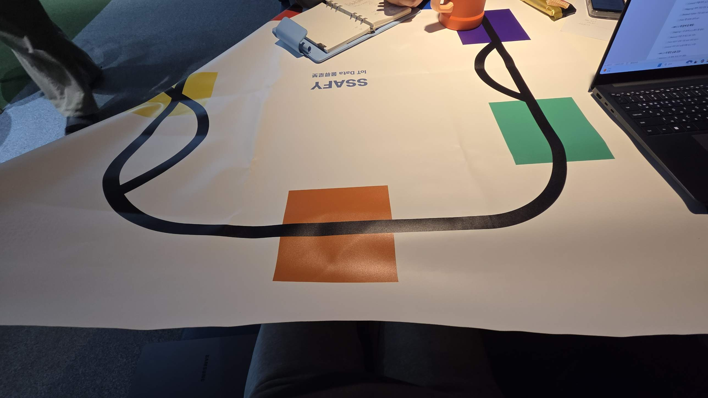
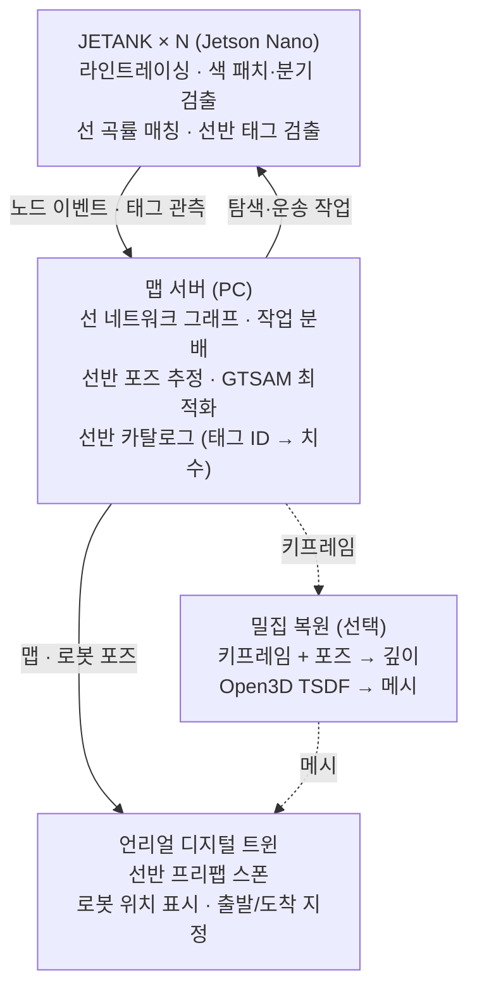

# JETANK 다중 AGV 맵 생성 설계 (depth camera 없음)

> 원본: [Claude 문서](https://claude.ai/artifact/4GkXZBfa7XJ8LTbqmY8aQJ) · 기준일 2026-11-02

## 개요

결론: depth camera 없이 기하를 직접 복원하는 SLAM 대신, 바닥 색 패치·분기점으로 로봇 위치를, 선반의 AprilTag로 구조물 위치를 실제 축척으로 추정하고, 3D 형상은 언리얼 프리팹으로 배치한다. 크기를 아는 패치와 태그가 단안 카메라의 스케일 모호성과 누적 오차를 보정하고, 모든 로봇이 같은 원점 패치를 공유해 맵 병합이 필요 없다. 현재 매트(루프 1개, 분기 2곳, 색 패치 4개)는 바닥 태그 없이 위치 추정이 가능하다.

요구사항

- 맵은 사람이 미리 만들지 않고, 로봇이 돌아다니며 생성한다.
- 여러 맵(창고 배치)에서 동작해야 한다.
- 로봇 위치와 창고 구조를 실제 축척으로 어느 정도 정확히 보여야 한다.
- AGV는 바닥 선(트랙) 위에서만 이동한다.
- depth camera는 가격·네트워크 대역폭 문제로 쓰지 않는다.
- 바닥·선반에 마커를 붙이는 것은 허용된다.

현재 트랙 매트:

범위: 위치 추정, 선 네트워크 맵, 선반 3D 배치, 언리얼 연동까지가 필수. 실제 형상의 밀집 복원은 선택 과제로 둔다.

## 하드웨어 제약

JETANK에는 단안 광각 카메라 하나뿐이고 오도메트리 센서가 없다. 키트 구성품은 IMX219-160 카메라, 0.91인치 OLED, 로봇팔 그리퍼, 기어모터 2개 등으로, 엔코더·IMU·라이다가 들어 있지 않다([판매처 구성품 목록](https://www.berrybase.de/it/waveshare-jetank-ai-kit-acce-4-dof-autonomer-roboter-deep-learning-8mp-kamera-fuer-jetson-nano)). 실제 보유 기체로 한 번 더 확인 필요.

| 제약 | 결과 | 대응 |
| --- | --- | --- |
| 단안 카메라 | 거리 스케일을 알 수 없음 | 크기를 아는 색 패치·선반 태그로 거리 계산 |
| 160° 어안 렌즈 | 일반 모델로는 PnP 오차 큼 | 어안 모델 캘리브레이션 |
| 엔코더·IMU 없음, 궤도형 | 휠 오도메트리 불가, 시간 기반 추정은 미끄러짐 | 색 패치·분기점 보정, 선 곡률 매칭, 필요시 IMU 추가 |
| 카메라가 로봇팔에 장착 | 팔 자세에 따라 카메라 위치가 바뀜 | 주행 중 팔 자세 고정 |
| Jetson Nano | 무거운 SLAM·딥러닝 실시간 구동 어려움 | 온보드는 검출만, 계산은 서버 |

## 전체 아키텍처

Jetson Nano는 검출만 하고 계산은 서버가 맡는다. 모든 로봇이 같은 원점 패치를 공유하므로 서버가 하나의 맵을 유지하고, 언리얼은 그 맵을 받아 그리기만 한다.

## 단계별 설계

### 0. 준비 (한 번만)

- 어안 캘리브레이션: `cv2.fisheye`와 체스보드로 내부 파라미터·왜곡 계수를 구한다. 로봇마다 따로 한다.
- 카메라-차체 변환: 주행용 팔 자세를 하나로 고정하고, 그 자세에서 카메라→차체 변환 `T_robot_cam`을 측정한다.
- 색 판별 설정: 카메라 화이트밸런스·노출을 고정하고, 실제 조명에서 패치별 HSV 범위를 기록한다.
- 매트 실측: 색 패치 크기, 패치·분기점 사이 선 길이를 줄자로 한 번 재 둔다. 맵 생성에는 쓰지 않고 정확도 검증용 정답으로만 쓴다.
- 원점: 출발 지점 색 패치를 월드 원점으로 정한다.
- 마커: 선반·구조물에만 AprilTag 36h11을 붙인다. 바닥 태그는 색 패치가 부족한 맵을 위한 예비로 둔다.

| ID 대역 | 용도 | 부착 위치 |
| --- | --- | --- |
| 1–99 | 예비: 색 패치가 부족한 맵의 바닥 노드 | 바닥 선 위 |
| 100–199 | 선반 | 선반 앞면 |
| 200–299 | 벽·출입구 등 구조물 | 벽면 |

### 1. 위치 추정: 색 패치 + 선 곡률 (로봇 온보드)

- 노드 이벤트: 색 패치를 지나거나 분기점에서 선이 갈라지거나 합쳐질 때 그 노드로 위치를 확정한다. 패치 색이 서로 다르면 색이 곧 노드 ID다.
- 패치 구간 정밀 보정: 패치 실제 크기를 알면, 화면에 보이는 동안 바닥면 호모그래피로 패치 모서리까지 거리를 cm 단위로 구한다.
- 패치 사이 구간: 화면 속 선 각도 변화로 곡률을 재고, 맵의 곡률 패턴과 맞춰 보는 1차원 파티클 필터로 엣지 위 진행 거리를 추정한다.
- 이벤트 시점 보정: 카메라는 앞을 보므로 패치가 화면 아래 끝을 통과하는 순간을 이벤트로 잡고, 그때 패치와 차체 사이 거리 오프셋을 한 번 측정해 둔다.
- 다른 맵에서 같은 색이 반복되면 직전 노드와 분기 방향 같은 그래프 맥락으로 구분한다.
- 바닥 VO는 주력으로 쓰지 않는다. 흰 바탕과 단색 선뿐이라 진행 방향으로 추적할 특징점이 부족하다.
- 선 위에서만 움직이므로 필요한 정보는 "어느 엣지 위, 시작 노드에서 몇 cm"라는 1차원 값이다.

### 2. 선 네트워크 맵 (탐색)

- 색 패치·분기점 = 노드, 노드 사이 선 = 엣지인 그래프를 만든다. 엣지 길이는 위치 필터의 진행 거리로 기록한다.
- 로봇은 DFS로 미탐색 엣지를 따라간다. 다중 로봇이면 서버가 미탐색 엣지를 로봇별로 배정한다.
- 모든 로봇이 같은 원점 패치를 공유하므로 맵 병합 단계가 따로 없다.
- 실제 축척 2D 배치는 선 각도를 적분해 구한다. 루프를 한 바퀴 돌아 같은 패치로 돌아오면 누적 오차를 루프 전체에 나눠 보정한다(루프 클로저).
- 이 그래프가 그대로 경로 계획(출발/도착지 지정)용 맵이 된다.

### 3. 선반·구조물 3D 맵

- 선반 태그 관측으로 월드 좌표를 계산한다: `T_world_shelf = T_world_robot × T_robot_cam × T_cam_tag`.
- 여러 시점의 관측을 모아 평균 또는 최적화한다. 태그 방향은 한 장면에서 튀기 쉬우므로 단일 관측은 쓰지 않는다.
- 서버에 선반 카탈로그(태그 ID → 종류, 폭·깊이·높이, 단 수)를 두고, 언리얼은 해당 좌표에 프리팹을 스폰한다.
- 마커 크기는 10cm 이상, 1.5m 이내 관측만 사용한다.

### 4. 전역 최적화 (권장)

- 로봇 포즈, 노드(색 패치·분기점) 포즈, 선반 태그 포즈를 노드로 하는 포즈 그래프를 GTSAM으로 최적화한다.
- 로봇과 바닥 노드에는 바닥 평면 위에 있다는 제약(z=0, 수평)을 추가한다.
- 같은 노드 재방문과 루프 클로저를 제약으로 넣는다.
- 탐색이 끝났을 때, 또는 새 관측이 일정량 쌓일 때마다 다시 돌린다.

### 5. 밀집 복원 (선택)

- 포즈를 이미 알고 있으므로 SLAM이 아니라 "포즈를 아는 영상 → 깊이 → 융합" 문제다.
- 깊이 후보: 연속 키프레임 모션 스테레오, 팔을 움직여 두 시점 촬영, 메트릭 단안 깊이 모델(어안 왜곡을 편 뒤 입력).
- 융합: Open3D TSDF로 메시 생성 → 언리얼 임포트. 전부 서버에서 처리한다.
- 데모용 보너스로는 녹화 영상을 COLMAP 또는 3D Gaussian Splatting으로 오프라인 처리하는 방법도 있다.

## 통신·메시지 설계

로봇은 영상을 보내지 않고 관측 결과만 보낸다. 메시지 하나가 수백 바이트 수준이라 다중 로봇이어도 대역폭 문제가 없다. 아래 필드 구성은 초안이며 팀 논의로 확정한다.

| 메시지 | 방향 | 주요 필드 | 주기 |
| --- | --- | --- | --- |
| node_event | 로봇 → 서버 | robot_id, timestamp, 노드 종류(색 패치/분기), 색 또는 분기 방향, 패치까지 거리 | 노드 통과 시 |
| tag_observation | 로봇 → 서버 | robot_id, timestamp, tag_id, T_cam_tag(위치+쿼터니언), 거리 | 선반 태그 검출 시 |
| odometry | 로봇 → 서버 | robot_id, timestamp, 현재 엣지, 진행 거리, 선 곡률 | 5–10Hz |
| robot_state | 로봇 → 서버 | robot_id, 모드(탐색/운송/대기), 배터리 | 1Hz |
| task | 서버 → 로봇 | 탐색할 엣지 또는 출발/도착 노드 | 이벤트 |
| map_update | 서버 → 언리얼 | 노드·엣지 목록, 선반 ID·종류·포즈 | 맵 변경 시 |
| robot_pose | 서버 → 언리얼 | robot_id, 월드 포즈 | 10Hz |
| keyframe (선택) | 로봇 → 서버 | robot_id, 포즈, 저해상도 JPEG | 정지 시 가끔 |

전송 수단은 WebSocket 또는 MQTT(JSON)로 시작하고, ROS2를 유지하기로 하면 같은 필드를 ROS2 메시지로 옮긴다.

## ROS 사용 여부와 시뮬레이션

제안: 본 파이프라인은 ROS 없이 파이썬으로 구현하고, 시뮬레이션 연동이 필요한 부분만 ROS2 브리지를 쓴다. ROS를 쓰려던 원래 이유인 3D 매핑 라이브러리가 이 구조에서는 필요 없기 때문이다.

| 기능 | ROS 없이 쓸 라이브러리 |
| --- | --- |
| 태그 검출·PnP | OpenCV, `pupil-apriltags` |
| 포즈 그래프 최적화 | GTSAM (파이썬 바인딩) |
| 밀집 복원 | Open3D |
| 로봇·서버·언리얼 통신 | WebSocket 또는 MQTT |

12월 재택 기간 시뮬레이션

- Gazebo에 실제 매트를 위에서 찍어 편 바닥 텍스처, AprilTag 텍스처를 붙인 선반 모델, JETANK 크기의 차체와 카메라를 배치한다.
- 시뮬레이션 카메라 영상을 실제와 같은 검출·매핑 코드에 그대로 넣는다. 영상 수신은 ROS2 브리지가 가장 간단하다.
- 시뮬레이션 카메라에도 160° 어안 왜곡을 넣어야 실제와 차이가 줄어든다.
- 정답 포즈를 알 수 있으므로 위치 추정 오차를 수치로 측정하기 좋다.

## 로드맵과 역할 분담

MVP는 3단계(선반 프리팹 스폰)까지이며, 각 단계는 앞 단계 결과 위에 쌓인다. 일정은 팀에서 정한다.

1. 캘리브레이션 + 단일 로봇 색 패치 기반 위치 추정, 정확도 측정
2. 선 네트워크 탐색 + 서버 그래프 맵
3. 선반 태그 → 언리얼 프리팹 스폰 (MVP)
4. 다중 로봇 작업 분배 + 포즈 그래프 최적화
5. 여유가 있으면 TSDF 밀집 복원

역할 분담 제안 (4인)

| 담당 | 범위 |
| --- | --- |
| A: 로봇 온보드 | 라인트레이싱, 색 패치·분기 검출, 위치 필터, 캘리브레이션 |
| B: 맵 서버 | 그래프 맵, 선반 위치 추정, 포즈 그래프 최적화 |
| C: 다중 로봇·통신 | 메시지 정의, 작업 분배, 시뮬레이션 환경 |
| D: 언리얼 트윈 | 프리팹 스폰, 로봇 표시, 출발/도착 지정 UI |

## 리스크

| 리스크 | 영향 | 대응 |
| --- | --- | --- |
| 광택·조명으로 색 오판별 | 엉뚱한 노드로 위치가 점프 | WB·노출 고정, HSV 범위 실측, 그래프 맥락으로 이상치 거부 |
| 패치 사이 구간 위치 부정확 | 로봇 표시가 튐 | 선 곡률 매칭, 필요시 IMU 추가 |
| 어안 캘리브레이션 품질 부족 | 패치 거리·태그 포즈 오차 증가 | 캘리브레이션 후 알려진 거리로 오차 검증 |
| 매트 주름·휨 | 호모그래피 거리 오차 | 매트를 평평하게 고정 |
| 원거리·사선 관측 시 방향 오차 | 선반 회전이 틀어짐 | 거리·각도 필터, 다중 관측 평균 |
| 모션 블러 | 패치·분기·태그 미검출 | 노드 근처 감속, 노출 고정 |
| 시뮬레이션과 실제 차이 | 12월 결과가 실기에서 안 맞음 | 어안 왜곡·노이즈와 실제 매트 텍스처 반영 |

## 미결정 사항

- [ ] ROS2 유지 여부와 통신 수단 (WebSocket / MQTT / ROS2)
- [ ] 원점으로 쓸 색 패치
- [ ] 패치 사이 위치 추정 보강 (곡률 매칭만 / IMU 추가)
- [ ] 다른 맵에서 색이 겹칠 때 구분 규칙
- [ ] 선반 태그 크기, 선반 카탈로그 종류와 실제 치수
- [ ] 밀집 복원(5단계)을 범위에 넣을지
