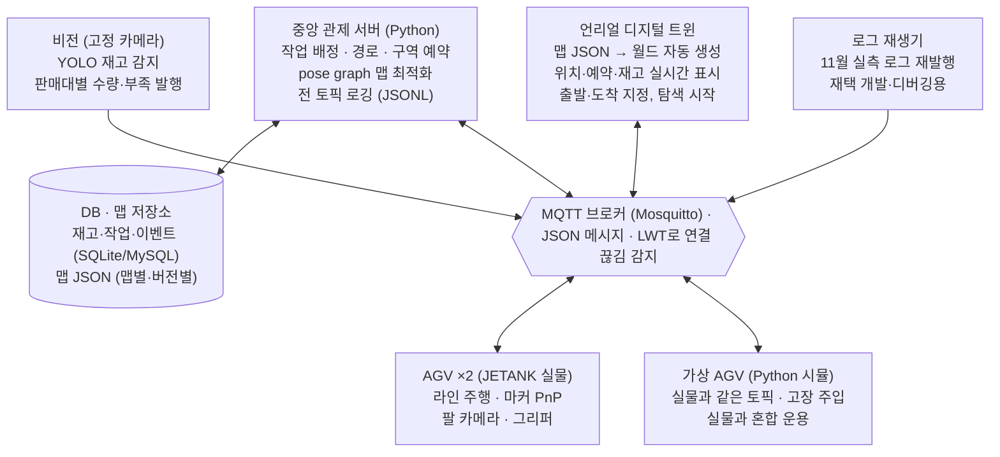

# 스마트 마트 물류 자동화 시스템 — 설계 문서 v0.2

작성: 2026-10-30 · 일정은 [roadmap.md](roadmap.md)를 기준으로 한다.

## 1. 개요와 설계 원칙

기획서(10/30 초안) 이후 논의를 반영해 ROS를 빼고 MQTT로 통신하며, 로봇이 마커를 따라 탐색하면서 맵을 직접 만들고 언리얼은 그 맵 데이터로 월드를 자동 생성한다.

범위는 기획서 1순위 시연 흐름(재고 부족 감지 → 작업 생성 → AGV 2대 운반 → 충돌 방지 → 재고 갱신 → 트윈 관제)에 **탐색 기반 협동 매핑**을 더한 것이다.

설계 원칙:

- **맵은 데이터다.** 사람이 언리얼 레벨을 모델링하지 않는다. 로봇이 만든 맵 JSON 하나를 스케줄러, 시뮬레이터, 언리얼이 함께 쓴다.
- **실물과 시뮬은 같은 인터페이스를 쓴다.** 서버와 트윈은 상대가 실물 로봇인지 가상 로봇인지 구분하지 않는다.
- **시간이 아니라 이벤트로 움직인다.** 로봇은 구역 점유권을 얻어야 진행하므로, 계획 시각과 실제 시각이 어긋나도 충돌로 이어지지 않는다.
- **명령은 구간 단위로 내린다.** 라인 추종과 모터 제어는 로봇 내부 사정이다.
- **실물이 필요한 작업은 11월에 끝낸다.** 12월 재택 기간에는 시뮬레이터와 실측 로그로 개발한다.

## 2. 시스템 아키텍처

모든 구성요소는 MQTT 브로커 하나를 거쳐 통신하고, DB와 맵 저장소에는 관제 서버만 직접 접근한다.



서버와 트윈은 상대가 실물 로봇인지 가상 로봇인지, 실시간인지 로그 재생인지 구분하지 않는다. 그래서 12월에도 같은 코드로 개발할 수 있다.

## 3. 통신 설계

통신은 MQTT(서버 PC의 Mosquitto 브로커) + JSON 메시지로 하고 ROS는 쓰지 않는다. JETANK 기본 이미지(JetBot 기반)에 ROS가 없고, SLAM·Nav2 같은 ROS 라이브러리가 단안 카메라·엔코더 없음 조건에 맞지 않으며, Jetson Nano에 ROS2를 올리는 비용이 크기 때문이다.

| 토픽 | 방향 | 주기 | 옵션 | 내용 |
| --- | --- | --- | --- | --- |
| `agv/{id}/order` | 서버 → 로봇 | 이벤트 | QoS 1 | 작업 ID, 경로 노드 목록, 진입 허가된 마지막 노드, 끝 동작 |
| `agv/{id}/state` | 로봇 → 서버 | 5~10Hz | QoS 0, retained | 마지막 노드, 현재 엣지, 진행률, 자세, 상태, 적재, 배터리 |
| `agv/{id}/event` | 로봇 → 서버 | 이벤트 | QoS 1 | 도착, 상차·하차 완료, 실패, 마커 인식 |
| `agv/{id}/obs` | 로봇 → 서버 | 노드마다 | QoS 1 | 매핑용 마커 관측, 분기 방향 |
| `agv/{id}/conn` | 브로커 | 연결 변화 | LWT, retained | online / offline |
| `fleet/map` | 서버 → 전체 | 맵 변경 시 | retained | 현재 맵 ID·버전과 맵 JSON |
| `fleet/reservations` | 서버 → 트윈 | 변경 시 | retained | 구역 점유 현황 |
| `fleet/tasks` | 서버 → 트윈 | 변경 시 | retained | 작업 큐와 상태 |
| `ui/command` | 트윈 → 서버 | 이벤트 | QoS 1 | 운반 요청(출발·도착), 탐색 시작·정지 |
| `vision/shelf/{shelf_id}` | 비전 → 서버 | 촬영마다 | QoS 1 | 품목별 수량, 부족 수량, 신뢰도 |

서버는 예약에 성공한 구간까지만 경로를 "해제"한다(`released_until`). 로봇은 해제된 노드까지만 가고 멈춰서 다음 해제를 기다린다. 이것이 7장 충돌 방지 규칙의 실행 수단이다.

```json
{"order_id": "T-0012", "seq": 3, "map_id": "layout_A@v4",
 "nodes": ["N3", "N4", "N7", "N9"], "released_until": "N7",
 "action_at_end": {"type": "unload", "shelf": "S2"}}
```

```json
{"ts": 1730271234.12, "map_id": "layout_A@v4", "last_node": "N4", "edge": ["N4", "N7"],
 "progress": 0.42, "pose": {"x": 1530, "y": 820, "th": 90, "src": "interp"},
 "status": "MOVING", "carrying": "P-cola", "battery": 0.78}
```

- **연결 끊김 감지**: 로봇은 접속할 때 LWT(Last Will)를 `offline`으로 등록한다. 연결이 끊기면 브로커가 대신 발행하고, 서버는 그 로봇의 점유를 유지한 채 안전 정지로 처리한다.
- **로깅·재생**: 서버의 로거가 모든 토픽을 수신 시각과 함께 JSONL로 저장한다. 재생 스크립트는 같은 간격으로 다시 발행한다. rosbag을 대신하며, 카메라 영상은 별도 동영상 파일로 녹화한다.
- **참고 표준**: 산업용 AGV 통신 표준 VDA 5050(MQTT + JSON, 좌표가 붙은 노드·엣지 목록으로 명령)의 구조를 참고했다. 그대로 따르지는 않는다.

## 4. 맵 데이터 설계

맵마다 맵 JSON 파일 하나를 두고, 재고·작업·로그는 DB에, 실시간 상태는 MQTT에 둔다. 좌표는 실제 축척(mm)이라 여러 맵을 같은 코드로 다루고 트윈에 실제 크기로 그릴 수 있다.

- **좌표계**: 단위 mm, 바닥 평면 2D(x, y, θ). 원점과 방향은 0번 마커가 정한다. 언리얼은 1 유닛 = 1cm로 환산한다.
- **버전**: 맵이 갱신되면 버전을 올린다. 명령과 상태에 `map_id@버전`을 넣고, 다른 버전 기준 명령은 로봇이 거부한다.

| 계층 | 내용 | 만드는 주체 |
| --- | --- | --- |
| 메타 | map_id, 버전, 단위, 원점 마커, 생성 시각 | 탐색 시작 시 서버 |
| 랜드마크 | 마커 ID별 위치·방향·불확실도 | pose graph 최적화 |
| 주행 네트워크 | 노드(마커와 연결), 엣지(형상, 방향성, 길이) | 협동 탐색 |
| 구조물 | 선반(위치, 크기, 칸 배치), 스테이션, 벽·장애물 폴리곤 | 선반 마커 인식, 벽은 3단계 |
| 운영 구역 | 공유 구역, 대기·대피 지점, 상하차 위치 | 자동 추출 후 사람이 보정 |

```json
{
  "map_id": "layout_A", "version": 4, "unit": "mm", "origin_marker": 0,
  "markers": [{"id": 11, "pose": [300, 300, 0], "sigma": [8, 8, 2]}],
  "nodes": [{"id": "N1", "marker": 11, "pos": [300, 340]}],
  "edges": [{"from": "N1", "to": "N2", "shape": [[300, 340], [900, 340]],
             "bidirectional": false, "lanes": 1}],
  "shelves": [{"id": "S1", "marker": 101, "pose": [1200, 400, 90],
               "size": [600, 250, 400], "slots": {"rows": 2, "cols": 3}}],
  "walls": [{"polygon": [[0, 0], [3000, 0], [3000, 2000], [0, 2000]]}],
  "zones": [{"id": "Z_cross1", "type": "shared", "nodes": ["N4", "N5"]},
            {"id": "W1", "type": "waiting", "node": "N6"}]
}
```

마커 ID 범위:

| ID | 용도 |
| --- | --- |
| 0 | 원점 |
| 1~99 | 바닥 노드 |
| 100~199 | 선반·스테이션 |
| 200~ | 로봇 상단 (천장 카메라를 쓸 경우) |

## 5. 탐색 기반 협동 매핑

사람은 바닥과 선반에 마커만 붙이고, 마커가 어디 있고 어떻게 연결되는지는 로봇들이 탐색하며 알아낸다. 마커의 실제 크기로 단안 카메라의 스케일 문제를, 마커 ID로 재방문 인식 문제를 해결한다.

### 5.1 마커 규격

- **종류**: AprilTag 36h11 (오인식이 적고 자세 정확도가 좋음). 후보로 ArUco 4×4.
- **크기**: 바닥 4~6cm, 선반은 멀리서 보이도록 더 크게. 검증 실험 후 확정한다.
- **배치**: 교차점·분기점·끝점·스테이션에는 필수, 긴 직선 구간은 50~80cm마다. 라인 인식을 방해하지 않도록 라인 옆에 일정한 오프셋으로 붙인다.
- **인쇄**: 무광 용지를 단단한 판에 평평하게 붙인다. 반사는 인식률을 크게 떨어뜨린다.

### 5.2 캘리브레이션

- 로봇별 카메라 내부 파라미터를 ChArUco 보드로 구한다. 광각 렌즈라 왜곡 보정이 필수다.
- 카메라가 팔에 달려 있으므로 **고정 팔 자세**(라인 주행 / 스캔 / 선반 확인)를 정하고, 자세마다 카메라와 몸체 사이 변환을 한 번 측정한다. 측정은 이 자세에서만 한다.
- 서보 반복 정밀도를 실측해 자세 오차를 확인한다.

### 5.3 관측: 엔코더 없이 마커끼리 잇기

마커 하나를 보면 카메라와 그 마커의 관계는 정확히 나오지만, 마커 A에서 B로 이동한 거리를 모르면 A와 B를 이을 수 없다. 연결 고리는 세 가지로 만든다.

1. **한 프레임 다중 마커 (주력)**: 노드에 도착하면 스캔 자세로 주변을 본다. 한 장에 마커 둘 이상이 보이면 그 사이 상대 위치가 바로 나온다.
2. **바닥 영상 이동량 (보조)**: 카메라 높이를 알면 연속 프레임의 바닥 이동으로 실제 이동 거리를 구할 수 있다. 바닥에 무늬가 있어야 한다.
3. **시간 × 속도 (약한 제약)**: 부정확하지만 대략적인 거리 제약으로 넣는다.

마커 설치 전에는 현재 트랙 매트의 색 패치와 분기점을 노드 랜드마크로 쓰는 실험을 먼저 한다. [색 패치 기반 위치 추정·매핑 실험](mapping/patch-localization.md) 참고.

### 5.4 최적화

- 바닥이 평면이므로 2D pose graph로 푼다. 변수는 마커 자세와 관측 시점의 로봇 자세, 제약은 마커 관측(거리가 멀수록 약하게)과 이동 제약이다.
- 0번 마커를 원점으로 고정한다. 마커 수십 개 규모라 scipy 최소제곱으로 충분하다.
- 결과로 좌표와 불확실도를 함께 얻어 맵 JSON에 저장한다. 같은 마커를 여러 번, 여러 로봇이 볼수록 정확해진다.

### 5.5 협동 탐색

- 교차점에서 카메라로 분기 방향을 인식해 **미탐색 분기(frontier)** 로 등록한다.
- 서버가 frontier 목록을 관리하며 쉬는 로봇에게 그래프 거리상 가장 가까운 분기를 배정한다. 마커 ID가 전역 공통이라 로봇별 맵이 저절로 합쳐진다.
- 미탐색 엣지에는 로봇 한 대만 진입한다. 탐색된 구간에서는 7장의 예약 규칙을 그대로 쓴다.
- frontier가 비면 최종 최적화 후 맵 JSON을 저장하고 `fleet/map`으로 발행한다.

### 5.6 단계

| 단계 | 대상 | 방법 | 우선순위 |
| --- | --- | --- | --- |
| 1 | 주행 네트워크 | 바닥 마커 + 라인 분기 인식 | 1순위 |
| 2 | 선반·스테이션 | 선반 마커 PnP, 치수는 선반 종류별 사전 정보 | 1순위 |
| 3 | 벽·장애물 | 바닥 경계 검출(평면 가정) 또는 서버 GPU의 단안 depth 추정 | 확장 |

### 5.7 대역폭

매핑 단계는 실시간일 필요가 없어서, 1fps 수준의 JPEG 키프레임만 보내거나 로봇에 저장했다가 끝난 뒤 올린다. 운영 중에는 위치·상태만 오간다. depth camera를 구하더라도 매핑 전용으로 한 대에만 달면 된다.

## 6. 운영 중 위치 추정

노드 마커를 볼 때 위치를 확정하고, 노드 사이는 엣지 형상 위의 진행률로 보간한다. 상태 메시지의 `pose.src`에 출처(`marker` / `interp`)를 넣는다.

- **마커 인식 시**: PnP로 위치·방향을 보정한다. 주행 중 모션 블러가 심하면 노드에서 잠깐 멈춰 인식한다.
- **노드 사이**: 경과 시간 × 실측 속도로 엣지 위 진행률을 추정한다. 바닥 영상 이동량이 되면 함께 쓴다.
- **노드 사이 보조 (제안)**: 라인 곡률을 맵의 곡률 패턴과 맞춰 진행 거리를 보강한다. [색 패치 기반 위치 추정](mapping/patch-localization.md) 3절 참고.
- **오차 특성**: 라인 위라 좌우 오차는 작고 진행 방향 오차가 쌓이며, 다음 마커에서 초기화된다. 직선 구간 중간 마커가 이 오차를 줄인다.
- **선택: 천장 카메라**: 위에서 보는 카메라 + 로봇 상단 마커로 노드 사이에서도 연속 위치를 얻는다. 평가 지표 "정차 오차(cm)"의 기준값으로도 쓸 수 있다. 카메라 한 대가 덮는 범위가 설치 높이에 따라 제한되고 렌즈 왜곡 보정이 필요하다.

## 7. 다중 AGV 작업 배정·경로·충돌 방지

구역 예약 기반으로 이벤트 구동 실행을 하고, 단일 차선·교차 구간은 다음 대기 지점까지 한 번에 예약해 데드락을 예방한다. 계획 순서를 강제하는 ADG는 2단계로 둔다.

### 7.1 작업 배정

- 작업 상태는 기획서 F-05를 따른다: PENDING → ASSIGNED → PICKING → MOVING → DELIVERING → VERIFIED → DONE, 예외는 FAILED / CANCELLED.
- 가용 로봇 중 상차 위치까지 그래프 거리가 가장 짧은 로봇에 배정한다.

### 7.2 경로 계획

- 1단계: 맵 그래프에서 A\* 또는 Dijkstra로 로봇별 최단 경로.
- 2단계: CBS 또는 우선순위 계획 + 시공간 예약으로 다른 로봇과 겹치지 않는 경로.

### 7.3 실행 규칙 (기획서 F-04 보강)

1. **점유 단위**는 노드, 엣지, 공유 구역이다. 구역 크기에 실측 정지거리를 반영한다.
2. 서버는 **예약에 성공한 구간까지만** 경로를 해제한다(`released_until`).
3. **단일 차선·교차 구간은 다음 대기 가능 지점까지 원자적으로 예약한다.** 끝까지 확보하지 못하면 진입하지 않는다. 정면 대치형 데드락을 예방하는 핵심 규칙이다.
4. 점유 해제는 로봇 후단이 구역을 완전히 벗어났다는 이벤트 이후에 한다.
5. 통신이 끊기면(LWT) 그 로봇의 점유는 유지하고 안전 정지로 처리한다. 상태 확인 전에는 강제 해제하지 않는다.
6. **교착 감지**: 대기 관계(wait-for graph)에서 사이클을 찾으면 우선순위가 낮은 로봇을 대피 노드로 보내거나 재계획한다. 둘 다 불가하면 운영자 개입을 요청한다.

### 7.4 계획 시각과 실제 시각이 다를 때

- 로봇은 시각이 아니라 점유권으로 진행하므로, 한 대가 늦어도 다른 로봇은 기다릴 뿐 충돌하지 않는다.
- 2단계: 계획 결과를 Action Dependency Graph(ADG)로 바꿔 "로봇2는 로봇1이 N4를 떠난 뒤 N4 진입" 같은 순서 제약으로 실행한다(Hönig et al., 2019). 예약 순서가 꼬이는 것을 막는다.
- 지연이 정해 둔 임계치를 넘으면 현재 위치 기준으로 재계획한다.

### 7.5 맵 설계 권장

트랙에 대피용 노드를 최소 하나 둔다. 어떤 정책이든 교착 해소가 훨씬 쉬워진다.

## 8. 디지털 트윈 (언리얼)

언리얼은 맵 JSON을 읽어 실행 중에 월드를 자동 생성하며, 손으로 모델링한 레벨은 두지 않는다. 맵이 바뀌어도 코드 수정 없이 JSON만 바꾸면 된다.

- **월드 생성**: 벽은 폴리곤을 돌출하고, 라인은 엣지 좌표로 스플라인 메시를 깔고, 선반은 크기·칸 수를 파라미터로 받는 블루프린트 하나를 재사용한다. 디버그용으로 마커 위치도 표시한다.
- **탐색 과정 표시**: `fleet/map`이 갱신될 때마다 월드를 다시 만들거나 늘려서, 맵이 채워지는 과정을 실시간으로 보여준다.
- **로봇 표시**: `state`를 5~10Hz로 받아 보간 이동한다. 마커 보정으로 위치가 튀면 부드럽게 수렴시킨다.
- **오버레이**: 계획 경로, 예약 구역, 작업 상태, 선반별 재고, 경고·오류.
- **사용자 제어**: 출발·도착 지정과 탐색 시작·정지를 `ui/command`로 보낸다. 판단은 서버가 한다.
- **연결 방식 (미결)**: 언리얼용 MQTT 클라이언트 플러그인을 쓸지, 서버가 WebSocket 브리지를 열고 언리얼 내장 WebSocket 모듈로 붙을지 정해야 한다. 언리얼 PC의 OS와 플러그인 지원 버전을 확인한 뒤 결정한다.
- **확장: 시뮬 모드**: 가상 로봇 액터가 실물과 같은 토픽을 발행한다. 트윈 로직과 섞이지 않도록 모드를 분리한다.
- **확장: 외관 레이어**: 맵별로 폰 스캔이나 Gaussian Splatting으로 외관을 따서 마커 기준으로 맵 좌표에 정렬해 얹는다. 로직은 맵 데이터, 외관은 재구성으로 나눈다.

## 9. 비전

재고 감지는 판매대마다 고정 카메라로 하고, 로봇 카메라는 라인 주행과 마커 인식에만 쓴다. 역할이 섞이지 않아 둘 다 안정적이다.

- **재고 감지**: 고정 웹캠 + YOLO·OpenCV. 출력은 기획서 F-01 형식(shelf_id, product_id, detected_count, shortage_count, confidence, captured_at)으로 `vision/shelf/{shelf_id}`에 발행한다. depth는 필요 없다.
- **학습·검증 데이터**: 11월에 실제 판매대 모형을 조명·각도를 바꿔 가며 촬영해 둔다.
- **상하차**: 선반·칸에 붙인 마커를 PnP로 읽어 팔의 목표 자세를 계산한다. 1차는 고정 픽업 지점, 자동 진열은 2순위다.

## 10. 시뮬레이션과 재택 개발

Gazebo 대신 실물과 같은 MQTT 토픽을 쓰는 Python 가상 로봇으로 12월 개발을 한다. 12월 작업(스케줄러, 충돌 방지, 트윈, 확장 실험)은 노드·엣지 수준 추상화면 충분하고 물리 엔진이 필요 없다.

- **가상 로봇**: 맵 JSON을 읽고, 명령받은 엣지를 실측 속도로 이동하며, `order`·`state`·`event` 규격을 실물과 똑같이 지킨다.
- **고장 주입**: 랜덤 지연, 정지, 상하차 실패, 통신 끊김(LWT 발생).
- **혼합 함대**: 실물 2대 + 가상 2대처럼 섞어 돌린다. 3~4대 확장 실험도 이걸로 한다.
- **가상 매핑**: 맵 JSON의 마커 위치에서 잡음 섞인 관측을 만들어 탐색·최적화 로직을 집에서 검증한다.
- **로그 재생**: 11월 실측 로그를 재발행해 서버와 트윈을 개발·디버깅한다.

11월 말까지 확보할 것:

- [ ] 실제 탐색으로 만든 맵 JSON 최소 1개
- [ ] 주행·탐색 MQTT 로그 (JSONL)
- [ ] 로봇별 속도, 정지거리, PnP 오차 실측값
- [ ] 판매대 이미지·영상, 주행 중 카메라 영상

## 11. 8주 로드맵

실물이 필요한 주행·매핑·상하차는 11월(W1~W4) 안에 끝내고, 12월(W5~W8)은 시뮬레이터와 로그로 소프트웨어를 고도화한다. 재택 전환 조건은 실제 맵 JSON 1개와 실측 로그·영상 확보다.

주차별 마일스톤·이슈·완료 기준은 [roadmap.md](roadmap.md)를 따른다. 설계 문서 v0.2 작성 당시의 주차 계획은 11/2 일정 검토에서 다음과 같이 바뀌었다.

- W3은 수동 주행 기반 매핑 파이프라인, W4는 자율·협동 탐색과 실물 2대 검증으로 나눴다.
- 구역 예약·충돌 방지 로직은 W3에 가상 AGV로 먼저 개발하고, W4에는 실물 검증만 한다.
- 비전은 이미지 수집(W2), 라벨링(W4), 학습(W5), 연동(W6)으로 나눴다.

## 12. 검증 실험과 평가 지표

11월 1~2주차 검증 실험 결과로 마커 크기·간격과 주행 방식을 확정한다. 수치 목표는 기획서 원칙대로 실측 후 팀 합의로 정한다.

| 검증 실험 | 측정 | 정해지는 것 |
| --- | --- | --- |
| 마커 하나의 PnP 정확도 | 거리·각도·팔 자세별 위치·각도 오차 | 마커 크기, 스캔 거리 |
| 한 프레임 두 마커 상대 위치 | 줄자 실측 대비 오차 | 마커 간격, 선반 마커 크기 |
| 주행 중 인식률 | 속도별 검출 성공률 | 노드 정지 여부 |
| 교차점 분기 인식 | 분기 방향 정답률 | 트랙 교차 형태 |
| 바닥 영상 이동량 | 직선 이동 거리 오차 | 보조 수단 채택 여부 |
| 서보 반복 정밀도 | 같은 자세 반복 시 카메라 자세 변화 | 고정 자세 수와 보정 방법 |

기획서 지표에 매핑 지표를 더한다.

| 지표 | 측정 방법 |
| --- | --- |
| 맵 정확도 (추가) | 최적화된 마커 위치와 줄자 실측 위치의 차이 |
| 협동 탐색 효율 (추가) | 탐색 완료 시간, 1대 대비 2대(시뮬은 3~4대) |
| 인식 정확도 | 판매대 품목·부족 감지 Precision/Recall |
| 충돌 안전 | 협소 구간 충돌 횟수, 교착 발생·해소 횟수 |
| 협업 처리량 | 같은 작업 세트 처리 시간, 1대 대비 2대 |
| 제어 정밀도 | 정차 지점 오차(cm), 천장 카메라 기준 |
| 데이터 정합성 | 실제 수량과 DB 수량 일치율 |
| 복구 능력 | 통신 끊김·상차 실패 후 정상 복귀율 |

## 13. 리스크와 미결 사항

가장 큰 리스크는 마커끼리 연결이 부족해 맵이 안 이어지는 것과, 탐색 매핑이 더해지며 범위가 커지는 것이다.

| 리스크 | 대응 |
| --- | --- |
| 한 프레임에 마커가 둘 이상 안 보여 맵이 끊김 | 선반 마커 대형화, 스캔 자세 추가, 바닥 영상 이동량 보조 |
| 팔 서보 오차로 카메라 자세가 흔들림 | 고정 자세만 사용, 실측 후 보정값 적용 |
| 주행 중 모션 블러 | 노드에서 정지 후 인식 |
| Jetson Nano 연산 부족 | 무거운 처리(최적화, depth 추정)는 서버에서 |
| 12월 실물 부재 | 11월 말 데이터 확보 목록 마감, 시뮬·로그 재생 |
| 범위 과다 | 3단계 매핑, 자동 진열, ADG, 외관 레이어는 확장으로 |

팀이 정해야 할 것(기한은 [roadmap.md](roadmap.md) 6장):

- [ ] 12월에 로봇을 집에 가져갈 수 있는가
- [ ] 관통PJT 요구사항·평가에 ROS 사용이 들어가는가
- [ ] 언리얼 실행 PC의 OS와 MQTT 연결 방식(플러그인 / WebSocket 브리지)
- [ ] 창고 모형 크기와 설치 공간 (천장 카메라 가능 여부)
- [ ] 매핑·비전 담당 배정
- [ ] 최종 시연이 대면인지 영상인지
- [ ] 마커 종류·크기 (검증 실험 후)
