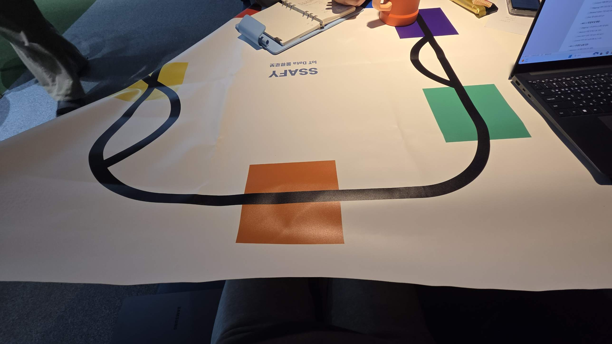

# 색 패치 기반 위치 추정·매핑 실험 (마커 설치 전)

[설계 문서 v0.2](../design.md)의 5장(탐색 기반 협동 매핑)·6장(운영 중 위치 추정)을 보조하는 문서다. 결론: 마커를 설치하기 전에도 현재 트랙 매트의 색 패치와 분기점을 노드 랜드마크로 써서 위치 추정과 2D 트랙 매핑을 실험할 수 있다. 이 방법은 v0.2의 마커 방식을 대체하지 않으며, 마커 설치 전 단계와 노드 사이 보조 수단으로 쓴다.

- 상태: 제안 (팀 검토 전)
- 기준: 설계 문서 v0.2. 이 문서와 v0.2가 다르면 v0.2를 따른다.

## 1. 현재 트랙 매트

사진 기준으로 큰 루프 하나에 분기(갈라지고 다시 합쳐지는 구간)가 두 곳 있고, 색 패치 4개(노랑·보라·초록·주황)가 모두 라인 위에 걸쳐 있다. 로봇이 패치를 반드시 밟고 지나가므로 랜드마크로 쓰기 좋다. 패치 크기와 패치 사이 거리는 실물에서 실측해 확정한다.

## 2. 무엇을 쓸 수 있나

| 랜드마크 | 얻는 것 | 한계 |
| --- | --- | --- |
| 색 패치 | 노드 ID(색이 서로 다르면 색이 곧 ID), 패치가 보이는 동안 cm 단위 거리 | 같은 색이 반복되는 맵에서는 그래프 맥락이 필요 |
| 분기·합류점 | 패치 사이 추가 노드 | 위치 정밀도는 패치보다 낮음 |
| 라인 곡률 | 노드 사이 진행 거리 보강 | 긴 직선 구간에서는 정보가 거의 없음 |

바닥 영상 이동량은 주력으로 쓰지 않는다. 이 매트는 흰 바탕과 단색 라인뿐이라 진행 방향으로 추적할 특징점이 부족하다. v0.2 12장의 "바닥 영상 이동량" 검증 실험에서 이 예상을 확인한다.

## 3. 위치 추정

v0.2 6장의 구조(노드에서 확정, 노드 사이 보간)를 그대로 따르고, 노드 랜드마크와 보간 수단만 바꾼다.

1. **노드 이벤트**: 색 패치를 지나거나 라인이 갈라지거나 합쳐질 때 그 노드로 위치를 확정한다.
2. **패치 구간 정밀 보정**: 패치 실측 크기를 알면, 화면에 보이는 동안 바닥면 호모그래피로 패치 모서리까지 거리를 구한다.
3. **이벤트 시점 보정**: 카메라가 앞을 보므로 패치가 화면 아래 끝을 통과하는 순간을 이벤트로 잡고, 그때 패치와 차체 사이 거리 오프셋을 한 번 실측해 둔다.
4. **노드 사이**: v0.2의 "경과 시간 × 실측 속도"에 더해, 화면 속 라인 각도 변화로 곡률을 재고 맵의 곡률 패턴과 맞춰 보는 1차원 파티클 필터로 엣지 위 진행 거리를 추정한다.
5. **색 중복 처리**: 같은 색이 반복되는 맵에서는 직전 노드와 분기 방향으로 구분한다.

## 4. 2D 트랙 매핑 실험

로봇과 현재 매트만으로 실측 축척의 2D 트랙 지도를 만들어, v0.2 5장 매핑 파이프라인의 스케일·누적 오차·루프 클로저 처리를 먼저 검증한다.

1. **카메라 설정**: 주행 고정 자세에서 카메라가 차체 앞 바닥을 보게 하고, 자동 노출·화이트밸런스를 잠근다(`nvarguscamerasrc`의 `aelock`, `awblock`). 처음엔 저속으로 주행한다.
2. **캘리브레이션**: v0.2 5.2절대로 ChArUco로 내부 파라미터를 구한다.
3. **녹화**: 루프와 분기 경로를 여러 바퀴 돌며 영상, 타임스탬프, 모터 명령을 저장한다. 알고리즘은 녹화본으로 오프라인 개발한다.
4. **버드아이뷰**: 로봇을 세운 상태에서 실측한 패치의 네 모서리로 바닥 호모그래피를 구하고, 모든 프레임을 위에서 본 mm 단위 영상으로 바꾼다.
5. **검출**: 라인은 검은색 임계값 마스크와 각도·곡률, 패치는 HSV 분류, 분기는 라인 덩어리가 갈라지거나 합쳐지는 순간으로 잡는다.
6. **모자이크**: 연속 버드아이뷰 프레임을 라인 마스크 기준으로 정합(ICP 또는 ECC)해 이어 붙인다. 커브에서는 회전과 이동이 잘 잡히고, 직선 구간의 진행 방향 이동은 속도 가정과 패치 모서리로 보완한다.
7. **루프 클로저**: 같은 패치를 다시 보면 누적 오차를 루프 전체에 나눈다. 최적화는 v0.2 5.4절과 같은 2D pose graph(scipy 최소제곱)로 한다.
8. **그래프 추출**: 모자이크에서 노드(패치·분기점)와 엣지(라인 형상, mm)를 뽑아 v0.2 4장 맵 JSON 형식으로 저장한다.

## 5. 평가

- **정답 지도**: 휴대폰으로 매트를 위에서 찍고, 매트 네 모서리(실측 치수)로 호모그래피를 펴서 만든다.
- **지표**: 패치 사이 거리 오차, 한 바퀴 누적 오차(루프 클로저 전후), 모자이크와 정답 지도의 라인 겹침 정도
- 결과는 v0.2 12장 "맵 정확도" 지표의 사전 측정값으로 쓴다.

## 6. 리스크

| 리스크 | 영향 | 대응 |
| --- | --- | --- |
| 광택 패치의 색 오판별 (사진상 주황 패치에 반사) | 엉뚱한 노드로 위치가 점프 | 노출·화이트밸런스 고정, 실제 조명에서 HSV 범위 실측, 그래프 맥락으로 이상치 거부 |
| 매트 주름·휨 | 버드아이뷰 거리 오차 | 매트를 최대한 평평하게 펴서 고정 |
| 긴 직선 구간 | 곡률 정보가 없어 진행 거리 오차 누적 | 속도 실측, 이후 직선 구간 마커(v0.2 5.1절)로 보완 |
| 모션 블러 | 패치·분기 미검출 | 노드 근처 감속 |

## 7. v0.2 규격에 대한 추가 제안 (합의 필요)

v0.2 규격을 바꾸지 않고 확장하는 제안이다. 합의 전에는 구현에서 쓰지 않는다.

- `agv/{id}/obs`: 노드 종류 필드(`marker` / `patch` / `branch`)와 패치 색 추가
- `agv/{id}/state`: `pose.src`에 `patch` 값 추가 (현재 `marker` / `interp`)
- 마커가 없는 맵의 임시 원점: 0번 마커 대신 지정한 색 패치를 원점으로 쓰는 규칙. 맵 JSON의 `origin_marker`를 어떻게 표현할지 함께 정한다.
