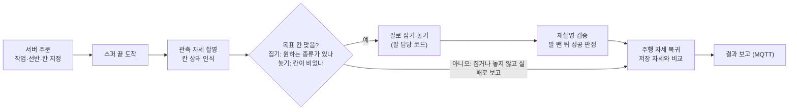

# JETANK 선반 집기·적재 Perception 설계

2026-11-24 · 설계 단계 (선반 미제작, 수치는 모두 예시)

## 개요

AGV 카메라 하나로 선반 1단의 칸마다 물체가 있는지, 무엇인지, 어디에 있는지 인식해서 팔 담당에게 로봇 기준 좌표로 넘긴다. 이 문서는 그 perception 쪽 설계와 구현 방향을 다룬다. 팔을 실제로 움직이는 제어는 다른 팀원 담당이다.

- **목표 데모**: 서버가 주문하면 로봇이 스퍼 끝에 서서 선반의 지정 칸에 있는 박스를 집어 싣고, 다른 선반으로 가서 지정 칸(또는 빈 칸)에 내려놓는다.
- **상태**: 설계 단계다. 선반이 아직 없어서 실측 결과가 없고, 문서의 수치는 모두 예시다.

## 확정된 전제와 제약

아래 조건이 바뀌면 3절의 방식 선택도 다시 봐야 한다.

| 항목 | 내용 | 설계에 주는 영향 |
| --- | --- | --- |
| OpenCV | 로봇 Python의 cv2에 `aruco`가 없다(`hasattr(cv2, 'aruco')` → False) | 마커 ID 방식을 쓰지 않는다. 기본 모듈(`findContours`, `solvePnP` 등)은 쓴다. pip로 contrib를 덮어쓰지 않는다(GStreamer가 빠져 CSI 카메라가 깨질 수 있음) |
| 물체 종류 | 색으로 구별한다. 같은 종류는 크기가 같다 | 종류별 크기는 config에 저장한다 |
| 선반 | 1단, 높이 고정, 자리마다 같은 높이. 쌓기 없음. 칸 여러 개를 옆으로 늘어놓는다 | 선반 윗면 평면 하나로 좌표 변환이 가능하다 |
| 카메라 | 팔에 달려 있다 | 집기용 관측 자세가 따로 필요하고, 주행 전에는 주행 자세로 반드시 돌아가야 한다 |
| 매트 | 바닥에 주황·보라·초록·노랑·빨강·파랑 패치가 있다 | 박스·선반 색은 패치 색과 겹치면 안 된다 |
| 정차 오차 | 스퍼 끝에서 좌우 ±2cm, 각도도 조금 틀어진다 | 인식 결과는 정차 오차에 영향을 받지 않아야 한다 |
| 거리 센서 | depth 카메라 없음 | 단안 카메라 + 평면 가정으로 거리를 구한다 |

## 인식 방식 결정

**선반 윗면 평면 좌표 변환(homography) + 색 판정**을 쓴다. 선반 높이가 고정이라 평면 하나로 화면 픽셀을 로봇 기준 mm로 바꿀 수 있고, 마커 없이 색 덩어리만으로 위치와 방향이 나온다. 팀원 문서(「JETANK 선반 적재 및 디지털 트윈 연동 설계」, 11/24)의 "카메라 먼저, 부족하면 센서 추가" 방향과 같고, 칸 영역을 정하는 방식만 바꿨다.

| 방식 | 판단 | 이유 |
| --- | --- | --- |
| 선반 윗면 좌표 변환 + 색 판정 | 채택 | 높이 고정이면 평면 하나로 충분하다. 마커가 필요 없고 보정이 단순하다. 평평한 표시(놓을 자리, 기준선)는 오차가 거의 없다 |
| 화면 고정 ROI + 색 비율 (팀원 문서 대안 B) | 고쳐서 채택 | 화면에 영역을 고정하면 정차 오차에 어긋난다. 칸 영역을 선반 좌표에서 정하고 화면으로 되돌리면 오차를 따라간다 |
| 검은 테두리 사각형 + `solvePnP` | 예비 | 높이와 상관없이 위치·방향이 나오고 aruco 없이 된다. 쌓기나 높이가 다른 선반이 생기면 이쪽으로 바꾼다 |
| ArUco 마커 | 불가 | 로봇 Python에 `cv2.aruco`가 없다 |
| 화면 속 크기로 거리 추정 | 버림 | 색 덩어리 경계가 조금만 흔들려도 거리가 크게 틀린다 |
| AGV 장착 ToF | 보류 | 거리는 좌표 변환에서 나온다. 카메라 검증에서 막히면 검토한다 |
| 스마트 선반(칸별 적외선 등) | 보류 | 종류 식별이 안 되고 칸 수만큼 배선이 늘어난다. AGV가 없을 때도 재고를 봐야 할 때만 검토한다 |
| 정밀 도킹 | 불필요 | 결과가 로봇 기준 좌표라 정차 오차가 결과에 그대로 반영된다. 팔이 닿는 범위 안에만 서면 된다 |

## 처리 파이프라인

한 번 찍어서 선반 위치 → 칸 영역 → 칸별 상태 → 박스 위치 순서로 내려간다.

1. **관측 자세**: 팔을 저장해 둔 집기용 관측 자세로 옮기고, 저장값과의 차이를 확인한다(`camtool arm` 방식). 서보가 1° 틀어지면 20cm 앞에서 3~4mm 오차가 생긴다.
2. **촬영 + 렌즈 왜곡 보정**: 기존 렌즈 보정값(`camera_calib.json`)을 쓴다.
3. **선반 검출**: 선반 앞 모서리(또는 윗면 기준선)를 찾아 좌표 변환한다. 로봇 기준 선반 위치(앞 거리, 좌우, 각도)가 나온다.
4. **칸 영역**: config의 칸 배치(칸 수, 너비, 선반 끝에서의 거리)로 선반 좌표에서 칸 사각형을 계산하고, 화면으로 되돌린다.
5. **칸 판정**: 칸 영역 안의 색 비율로 `종류` / `empty` / `unknown`을 정한다. 문턱은 촬영 실험으로 정한다.
6. **박스 위치·방향**: 색 덩어리의 **아래 앞 모서리**(선반에 닿는 선) 양 끝점을 변환한다. 두 점의 가운데에서 config의 박스 깊이 절반만큼 안쪽이 중심이고, 두 점을 잇는 선의 각도가 yaw다.
    - 덩어리 중심을 그대로 변환하면 안 된다. 중심은 평면 위에 떠 있어서, 높이 40mm 박스를 30° 아래로 내려다보면 30mm 넘게 멀리 찍힌다.
7. **걸러내기**: 검출한 크기가 config 크기와 많이 다르거나 가려져 있으면 `unknown`으로 둔다. `unknown` 칸에는 집거나 놓지 않는다.
8. **출력**: 칸 상태 목록(5절 형식)과 디버그 이미지(칸 영역, 판정, 아래 모서리 표시)를 남긴다.

## 좌표계와 팔 담당과의 인터페이스

perception은 칸마다 상태와 로봇 기준 좌표를 넘기고, 팔 담당은 그 좌표로 팔을 움직인다. 이 형식만 지키면 인식 방식을 바꿔도 팔 쪽 코드는 그대로다.

**좌표계 (제안, 팔 담당과 확정 필요)**

- 원점: 궤도 가운데 바닥 또는 팔 1번 서보 축 중 하나
- 축: x 앞, y 왼쪽, z 위. 단위 mm. yaw는 x축 기준 반시계 방향 도(°)
- 보정할 때 체커보드를 이 좌표계에서 알려진 위치에 두면, 좌표 변환 결과가 바로 이 좌표계로 나온다

**출력 형식 (예시)**

```json
{
  "frame": "robot_base",
  "stamp": 1764000000.0,
  "arm_pose": [512, 400, 300, 512],
  "shelf": { "ok": true, "x_mm": 140, "y_mm": 4, "yaw_deg": -2.5 },
  "slots": [
    { "slot": 1, "state": "box_pink", "center_mm": [160, -60, 70], "yaw_deg": 3.0, "ratio": 0.72 },
    { "slot": 2, "state": "empty",    "center_mm": [160,   0, 50], "ratio": 0.02 },
    { "slot": 3, "state": "unknown",  "center_mm": [160,  60, 50], "ratio": 0.31 }
  ]
}
```

- `state`: config의 종류 이름, `empty`, `unknown` 중 하나
- `center_mm`: 박스가 있으면 박스 중심(z는 선반 높이 + 집을 높이), 비었으면 칸 가운데(놓을 자리)
- `arm_pose`: 찍을 때의 서보 값. 관측 자세가 저장값과 다르면 결과를 믿지 않는다
- 함수 형태는 `perceive_shelf(frame, cfg) -> ShelfObs` 하나로 둔다

## 설정(config) 구조

두 로봇에 같은 값은 공통 파일에, 카메라·조명·자세에 따라 달라지는 값은 로봇 폴더에 둔다. 주행 설정과 같은 방식이다.

| 값 | 위치 | 이유 |
| --- | --- | --- |
| 물체 종류 이름, 크기, 집을 높이 | 공통 (`agv/config/explore.json` 또는 `objects.json`) | 물체는 두 로봇이 같다 |
| 선반 높이, 칸 수·너비·위치 | 공통 | 선반은 하나로 정해져 있다 |
| 물체·선반 색 문턱 | 로봇별 (`agv/config/robots/<ID>/`) | 카메라와 조명마다 다르다 |
| 집기용 관측 자세 서보 값 | 로봇별 | 팔 조립이 로봇마다 조금씩 다르다 |
| 선반 윗면 좌표 변환 행렬 | 로봇별 | 관측 자세에서 잰 값이다. 자세를 다시 저장하면 다시 잰다 |

공통 부분 예시(수치는 임시):

```json
"objects": {
  "box_pink":  { "size_mm": [40, 40, 40], "grip_z_mm": 20 },
  "box_white": { "size_mm": [40, 40, 60], "grip_z_mm": 30 }
},
"shelf": {
  "height_mm": 50,
  "slot_count": 3,
  "slot_width_mm": 80,
  "first_slot_offset_mm": 20,
  "slot_depth_mm": 70
}
```

## 집기·놓기 작업 흐름과 서버 연동

한 작업은 서버 주문에서 시작해 결과 보고로 끝난다. 성공하든 실패하든 팔을 주행 자세로 되돌린 뒤에만 보고하고 다음 주행을 시작한다.



목표 칸이 맞지 않으면 팔을 움직이지 않고 실패로 보고한다. 재촬영 검증이 실패해도 같은 길로 주행 자세에 돌아가 결과를 보낸다.

**MQTT 결과 필드 (제안, 서버-로봇 규약에 추가)**

| 필드 | 값 |
| --- | --- |
| `agv_id` | `physical-1`, `physical-2` |
| `task_id` | 서버가 준 작업 ID |
| `action` | `pick` \| `place` |
| `shelf_id`, `slot_id` | 작업한 선반과 칸 |
| `object_type` | 집거나 놓은 물체 종류 |
| `result` | `success` \| `fail` |
| `reason` | `slot_empty`, `wrong_type`, `slot_occupied`, `not_visible`, `pose_mismatch`, `verify_failed`, `arm_error` |
| `slots` | 방금 본 칸 상태 목록(선택). 트윈이 선반 재고를 갱신할 때 쓴다 |

선반 ID는 로봇이 인식하지 않는다. 서버가 어느 스퍼로 보냈는지로 이미 알고 있다. 트윈은 서버가 확정한 결과만 반영한다.

## 선반 설계 요구사항 (팀에 제안)

선반 규격을 기다리지 말고, 팔 도달 범위와 카메라 시야에 맞춰 선반을 정하자고 제안한다. 선반은 만들기 나름이지만 팔 길이와 시야는 못 바꾼다.

| 항목 | 제안 | 이유 |
| --- | --- | --- |
| 높이 | 팔이 닿는 범위 안에서 하나로 고정. 모든 선반 같은 높이 | 좌표 변환이 선반 윗면 높이에 맞춰져 있다 |
| 위치 | 스퍼 끝에 섰을 때 선반 앞 모서리가 로봇 앞 일정 거리(팔 담당 측정 후 결정) | 팔이 모든 칸에 닿아야 한다 |
| 칸 수 | 처음에는 3칸. 한 자리에서 팔이 닿는 좌우 범위로 정한다 | 끝 칸은 멀고 비스듬해 검출과 집기가 모두 어렵다 |
| 칸 너비 | 박스 너비 + 한쪽 1.5~2cm 이상 | 팔의 놓기 오차를 받아준다 |
| 칸 구분 | 높은 벽 대신 선을 그리거나 낮은 턱 | 비스듬히 보이는 옆 칸이 가려지지 않게 |
| 칸 입구 | 3D 프린트라면 비스듬하게(모따기) | 조금 어긋나게 놓아도 미끄러져 들어간다. 인식 정확도를 올리는 것보다 싸다 |
| 윗면 색 | 흰색이나 회색 무채색 | 박스·패치 색과 구분되고, 박스 아래 모서리가 잘 보인다 |
| 기준선 | 윗면 앞 모서리를 대비되는 색으로 표시(예: 검은 테이프) | 로봇 기준 선반 위치·각도를 여기서 잰다 |
| 놓을 자리 | 칸 가운데에 평평한 표시(선택) | 높이 0이라 좌표 변환 오차가 거의 없다 |

박스 색은 패치에 없는 색(흰색, 분홍, 하늘색, 갈색 등)에서 2~3가지로 고른다. 흰 박스를 쓰면 선반 윗면은 회색으로 한다.

## 위험 요소와 대응

가장 먼저 확인할 것은 맨 아래 두 줄, 박스를 든 채 주행할 때 카메라가 가려지는지와 주행 자세 복귀다. 둘 다 팔 담당과 먼저 정해야 한다.

| 위험 | 영향 | 대응 |
| --- | --- | --- |
| 박스·선반 색이 패치나 조명과 겹침 | 종류를 잘못 판정 | 패치에 없는 색 2~3종, `autocolor`처럼 영상으로 색 문턱 잡는 도구 |
| 관측 자세 반복성 | 좌표 오차 (1°에 3~4mm) | 저장값과 차이를 확인하고, 크면 다시 자세 잡기 또는 경고 |
| 가림 (옆 박스, 칸 벽, 팔 그림자) | 칸 판정 불가 | 낮은 칸 구분, 선반 가운데를 위에서 내려다보는 자세, 애매하면 `unknown` |
| 끝 칸이 작고 비스듬히 보임 | 검출률 저하 | 3칸부터 시작해 끝 칸 검출률을 먼저 잰다 |
| 팔이 끝 칸까지 안 닿음 | 집기·놓기 불가 | 칸 수를 줄이거나 칸별 정차(선이 선반과 나란해야 해서 맵 수정 필요) |
| 선반 높이가 바뀜 | 좌표 변환 무효 | 다시 보정, 또는 검은 테두리 + `solvePnP`로 전환 |
| 박스를 든 채 주행하면 카메라가 가려짐 | 라인 추종 불가 | 싣는 위치와 운반 자세를 팔 담당과 먼저 정한다 |
| 작업 뒤 주행 자세 복귀 누락 | 라인 추종·`ctrl_ahead_mm` 보정값 무효 | 작업 마지막 단계에 복귀하고, 저장 자세와 차이를 확인한 뒤 출발 |

## 구현 순서와 검증 계획

선반이 없어도 1~5는 지금 할 수 있다. 선반 규격에 묶인 값은 모두 config로 빼 두어서, 선반이 나오면 숫자만 바꾼다.

**지금 (선반 없이)**

1. 출력 형식과 좌표계를 팔 담당과 맞춘다(5절).
2. 색 판정 모듈: 박스 색 문턱, 색 덩어리, 아래 앞 모서리 찾기. 책상 위 사진과 영상으로 만든다.
3. 칸 판정 로직: 선반 좌표 → 칸 영역 → 화면 역투영 → 판정. 종이로 만든 임시 선반이나 합성 이미지로 오프라인 테스트한다.
4. 도구: `agv.tools.*` 형식으로 사진 폴더를 넣으면 칸 상태와 디버그 이미지를 내는 명령을 만든다.
5. serve 모드에 집기·놓기 단계 자리를 만들고, MQTT 결과 필드를 서버 규약 초안에 넣는다(7절).

**선반이 생기면**

6. 집기용 관측 자세를 저장하고, 선반 윗면에 체커보드를 놓아 좌표 변환을 보정한다.
7. 사진 세트: 박스 배치를 바꿔 가며 정위치, 좌우 ±2cm, ±5° 돌린 상태로 15~20장 찍는다.
8. 노트북에서 4번 도구로 판정하고, 줄자로 잰 위치와 비교한다.
9. 팔 담당과 연결해 집기, 놓기, 놓은 뒤 검증까지 한다.

**통과 기준 (제안)**

- 칸 상태: 7번 사진 세트에서 틀린 판정 0. `unknown`은 허용하되 정위치 사진에서는 없어야 한다.
- 박스 중심: 줄자 값과의 차이가 그리퍼 허용 오차 안(팔 담당에게 받을 값).
- 놓은 뒤 검증: 성공·실패를 10번 중 10번 맞힌다.

이걸 통과하면 ToF나 스마트 선반은 필요 없다고 본다.

## 미정 사항 / 팀과 정할 것

첫 두 항목(좌표 원점, 운반 자세)이 정해져야 팔과 perception을 따로 진행할 수 있다.

- [ ] 좌표 원점과 축 확정 (팔 담당)
- [ ] 박스를 어디에 싣고 어떤 자세로 운반하는지, 그때 카메라가 가려지는지 (팔 담당)
- [ ] 그리퍼 허용 오차, 박스 방향(yaw)을 맞춰야 하는지 (팔 담당)
- [ ] 팔 도달 범위 측정 → 선반 높이, 로봇과의 거리, 칸 수 결정
- [ ] 박스 크기와 색 종류
- [ ] 선반 앞 모서리 기준선과 칸 표시 방식
- [ ] 놓을 칸을 누가 고르는지: 서버가 `slot_id`를 지정 vs 로봇이 빈 칸을 골라 보고
- [ ] MQTT 결과 필드를 서버-로봇 규약에 반영
