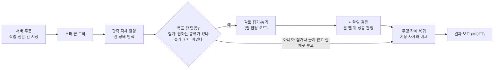

# JETANK 선반 집기·적재 Perception 설계

2026-11-24 작성 · 2026-11-25 수정 · 설계 단계 (선반 미제작, 수치는 모두 예시)

## 개요

AGV 카메라 하나로 선반 1단의 칸마다 물체가 있는지, 무엇인지, 어디에 있는지 인식해서 팔 담당에게 로봇 기준 좌표로 넘긴다. 물체는 박스에 붙인 ArUco 마커로 식별하고, 검출은 OpenCV aruco 모듈 없이 직접 구현한다. 팔을 실제로 움직이는 제어는 다른 팀원 담당이다.

- **목표 데모**: 서버가 주문하면 로봇이 스퍼 끝에 서서 선반의 지정 칸에 있는 박스를 집어 싣고, 다른 선반으로 가서 지정 칸에 내려놓는다. 집을 칸과 놓을 칸은 모두 서버가 정한다.
- **상태**: 설계 단계다. 선반이 아직 없어서 실측 결과가 없고, 문서의 수치는 모두 예시다.
- **11/25 변경**: 물체 식별을 색 판정에서 직접 구현한 ArUco 마커로 바꿨다. 좌표 원점은 기존 AGV 코드 기준(차체 회전 중심)으로 확정했다. 카메라가 팔 끝이 아니라 아래쪽 회전 받침에 달려 있다는 점을 반영했다. 선반(높이 약 150mm, 4칸 1줄)과 사양 기반 기본값을 넣었고, 카메라가 선반 윗면보다 낮아 선반 마커와 칸 바닥 마커를 칸 앞면 마커로 바꿨다.
- **11/26 변경**: 새 매트(맵 `mat_ssafy_v3`)에 선반이 6개다(N01 정렬 안 된 물체, N02 우유, N03 휴지, N04 계란, N05 주스, N06 정렬된 물체, 모두 4칸). 칸 마커 ID를 선반마다 다르게(1~24) 하고, 물체는 종류마다 마커 하나(우유 30, 휴지 31, 계란 32, 주스 33)로 정했다.

## 결정 기록 (원래 합의와 달라진 점)

원래 합의(팀원 문서 「JETANK 선반 적재 및 디지털 트윈 연동 설계」, 11/24)에는 없던 내용이다. 마지막 줄은 선반 제작에 영향이 있어 팀 확인이 필요하다.

| 날짜 | 결정 | 원래 합의·전제 | 이유 | 상태 |
| --- | --- | --- | --- | --- |
| 11/25 | 물체 식별은 박스 앞면 ArUco 마커(`DICT_4X4_50`), 검출은 직접 구현 | 카메라 HSV 색 인식(팀원 문서), 색 판정(11/24 초안) | 로봇 Python에 `cv2.aruco`가 없고, 색은 매트 패치 색·조명과 겹친다 | 확정 |
| 11/25 | 좌표 원점은 차체 회전 중심(기존 AGV 코드 기준) | 없음 | 맵 위 로봇 자세와 같은 점이라 바로 맵 좌표로 바꾼다 | 확정 |
| 11/25 | 집을 칸·놓을 칸은 서버가 `slot_id`로 지정 | 서버가 빈 슬롯 확인·예약(팀원 문서) | 로봇은 지정 칸이 맞는지만 확인한다 | 확정 |
| 11/25 | **칸 위치와 빈 칸은 칸 앞면 마커로 판단**: 선반 앞면에 칸마다 마커 하나, 그 칸에 박스 마커가 없으면 빈 칸. 박스는 앞 모서리에서 15mm 이내, 선반 앞면은 약 35mm 두께 | 화면 고정 ROI + 색 비율, 정밀 도킹(팀원 문서), 선반 마커 + 칸 바닥 마커(11/25 초안) | 카메라(약 115mm)가 선반 윗면(약 150mm)보다 낮아 윗면이 안 보인다. 앞면 마커는 정차 오차가 있어도 칸을 정확히 짚는다 | 팀 확인 필요(선반 제작) |

## 확정된 전제와 제약

아래 조건이 바뀌면 3절의 방식 선택도 다시 봐야 한다.

| 항목 | 내용 | 설계에 주는 영향 |
| --- | --- | --- |
| OpenCV | 로봇 Python(3.6, OpenCV 4.1)에 `cv2.aruco`가 없다(`hasattr(cv2, 'aruco')` → False) | ArUco 검출·디코딩을 기본 모듈(`adaptiveThreshold`, `findContours`, `warpPerspective`, `solvePnP`)로 직접 구현한다. pip로 contrib를 덮어쓰지 않는다(GStreamer가 빠져 CSI 카메라가 깨질 수 있음) |
| 물체 식별 | 박스마다 카메라 쪽 면에 ArUco 마커를 붙인다. 마커 ID로 종류(필요하면 개체)를 구별한다. 같은 종류는 크기가 같다 | ID 대응과 종류별 크기는 config에 둔다. 박스 색 제약은 없다 |
| 선반 | 1단, 높이 고정, 자리마다 같은 높이. 쌓기 없음. 칸 여러 개를 옆으로 늘어놓는다 | 선반 높이를 검출 결과를 걸러내는 제약으로 쓸 수 있다 |
| 카메라 | 팔 아래쪽 회전 받침에 달려 있고 화각이 넓다. 시야는 1번(받침 좌우, 팔과 같이 돎)과 5번(카메라 상하)만 정하고, 2·3번 팔 관절은 카메라를 움직이지 않는다(렌즈 보정은 보통 어안 모델) | 관측은 5번(필요하면 1번)만 바꾸면 되고, 팔이 움직여도 카메라 → 몸체 변환은 그대로다. 박스를 들 때는 2·3번으로 올리면 시야가 안 바뀐다. 주행 전에는 1·5번을 주행 자세로 되돌린다. 마커 꼭짓점은 왜곡을 편 뒤 `solvePnP`에 넣는다 |
| 해상도 | 주행은 320x240, 센서 원본은 1280x720 | 마커 인식은 원본 해상도 한 장으로 한다. 320x240에서는 마커 칸이 몇 픽셀밖에 안 된다 |
| 정차 오차 | 스퍼 끝에서 좌우 ±2cm, 각도도 조금 틀어진다 | 인식 결과는 정차 오차에 영향을 받지 않아야 한다 |
| 거리 센서 | depth 카메라 없음 | 마커 실제 크기로 거리를 구한다 |

## 인식 방식 결정

**직접 구현한 ArUco 검출 + 마커 꼭짓점 자세 계산**(`solvePnP`)으로 박스를 식별하고 위치·방향을 구한다. 마커 ID로 종류가 확실히 갈리고, 꼭짓점 4개로 높이와 상관없이 3D 자세가 나온다. 그래서 색 덩어리 방식의 약점(조명·패치 색 혼동, 아래 모서리 찾기)이 없어진다. 선반 높이가 고정이라는 점은 검출 결과를 걸러내는 제약으로 쓴다.

| 방식 | 판단 | 이유 |
| --- | --- | --- |
| 직접 구현 ArUco + `solvePnP` | 채택 | ID로 종류를 식별하고 꼭짓점으로 위치·방향을 구한다. 기본 모듈만 쓴다. 사전(비트 패턴)은 표준 `DICT_4X4_50`을 그대로 써서 마커는 기존 생성기로 뽑는다 |
| `cv2.aruco` | 로봇에서는 불가 | 로봇 Python에 없다. 노트북(OpenCV 4.7 이상 또는 contrib)에서 직접 구현 결과를 검증하는 기준으로만 쓴다 |
| 칸 영역을 선반 좌표에서 정하기 (팀원 문서 대안 B를 고침) | 채택 | 화면에 영역을 고정하면 정차 오차에 어긋난다. 선반 마커로 선반 위치를 재고, 칸 영역은 선반 좌표에서 계산한다 |
| 색 덩어리 + 선반 윗면 좌표 변환 | 예비 | 마커가 가려지거나 작게 보일 때 칸 점유만 확인하는 용도다. 종류 식별은 하지 않는다 |
| 화면 속 크기로 거리 추정 | 버림 | 마커 꼭짓점 `solvePnP`가 훨씬 정확하다 |
| AGV 장착 ToF | 보류 | 거리는 마커 자세에서 나온다. 카메라 검증에서 막히면 검토한다 |
| 스마트 선반(칸별 적외선 등) | 보류 | 종류 식별이 안 되고 칸 수만큼 배선이 늘어난다. AGV가 없을 때도 재고를 봐야 할 때만 검토한다 |
| 정밀 도킹 | 불필요 | 결과가 로봇 기준 좌표라 정차 오차가 결과에 그대로 반영된다. 팔이 닿는 범위 안에만 서면 된다 |

## 처리 파이프라인

원본 해상도로 한 장 찍어서 마커 검출 → 선반 위치 → 칸 영역 → 박스 배정 순서로 내려간다. 3~5가 직접 구현할 마커 검출기다.

1. **관측 자세**: 1번을 정면(0°)에 두고 5번을 선반 쪽으로 올린 관측 자세로 맞추고, 저장값과의 차이를 확인한다(`camtool arm` 방식). 팔(2·3번)은 화면을 가리지 않는 자리에 둔다. 1·5번이 1° 틀어지면 20cm 앞에서 3~4mm 오차가 생긴다.
2. **원본 해상도 촬영**: 주행 해상도(320x240)가 아니라 센서 원본(1280x720) 한 장을 찍는다. 렌즈 보정값은 두 해상도용이 다 있다.
3. **마커 후보 찾기**: 회색조 → `adaptiveThreshold`(반전) → `findContours` → `approxPolyDP`로 볼록 사각형만 남긴다. 너무 작거나 길쭉한 것은 버리고, `cornerSubPix`로 꼭짓점을 다듬는다.
4. **비트 읽기**: 후보를 `warpPerspective`로 정사각형으로 펴고 Otsu로 이진화한다. 4x4 마커는 테두리 포함 6x6 칸이라, 칸마다 가운데 부분의 흑백 다수결로 읽는다. 바깥 테두리 칸이 모두 검은색이 아니면 버린다.
5. **ID 맞추기**: 읽은 16비트를 사전의 각 코드와 네 방향 회전으로 비교해 해밍 거리가 가장 작은 것을 고른다. 허용값(예: 1비트)을 넘으면 버린다. 맞은 회전으로 꼭짓점 순서를 정한다.
6. **자세 계산**: 꼭짓점을 렌즈 보정으로 편 뒤(`camcalib`의 `undistort_points`), 마커 실제 크기로 `solvePnP`를 푼다. 카메라 → 로봇 몸체 변환(5절)을 곱해 로봇 기준 좌표로 바꾼다.
    - 평면 마커는 기울기가 두 가지로 풀릴 수 있다(뒤집힘 모호성). 박스 앞면 마커는 세로로 서 있어야 하므로 법선이 수평에 가까운 해를 고르고, 마커 중심 높이가 선반 높이 + 붙인 높이와 맞는지 확인한다.
7. **선반 위치**: 칸 앞면 마커(선반 앞면, 칸마다 하나)로 로봇 기준 선반 위치·각도와 칸 위치를 구한다. 마커가 하나만 보여도 config의 칸 배치로 나머지 칸을 계산한다. 마커 ID로 어느 선반·칸인지도 안다.
8. **칸 배정**: 박스 마커를 칸 영역에 넣어 칸마다 종류를 정한다. 박스 중심은 마커 중심에서 config의 박스 깊이 절반만큼 안쪽이고, yaw는 마커 방향이다. 한 칸에 마커가 둘이면 `unknown`이다.
9. **빈 칸 확인**: 칸 앞면 마커가 보이고 그 칸 영역에 박스 마커가 없으면 `empty`, 칸 앞면 마커도 안 보이면 `unknown`이다. 카메라(높이 약 115mm)가 선반 윗면(150mm)보다 낮아 윗면은 보이지 않으므로, 칸 바닥 마커나 윗면 색으로는 판정하지 않는다. `unknown` 칸에는 집거나 놓지 않는다.
10. **출력**: 칸 상태 목록(5절 형식)과 디버그 이미지(마커 테두리·ID, 칸 영역, 판정)를 남긴다.

## 좌표계와 팔 담당과의 인터페이스

좌표계는 기존 AGV 코드 기준을 그대로 따른다. perception은 칸마다 상태와 이 좌표계의 위치를 넘기고, 팔 담당은 그 좌표로 팔을 움직인다. 이 형식만 지키면 인식 방식을 바꿔도 팔 쪽 코드는 그대로다.

**로봇 몸체 좌표계 (확정, 기존 코드와 같음)**

- 원점: 차체 회전 중심(궤도 가운데) 바닥. `geom.ctrl_ahead_mm`, 스퍼 주차(`recover.park_back_mm`), 맵 위 로봇 자세 `(x, y, th)`가 모두 이 점 기준이다.
- 축: x 앞, y 왼쪽, z 위. 단위 mm. 방향은 x축에서 반시계로 잰 도(°)다(`topo/shape.py`, `link/geometry.py`와 같은 수학 좌표).
- 맵 좌표로 바로 바꿀 수 있다. 로봇 자세 `(x, y, th)`로 회전·이동하면 선반·박스의 맵 위치가 나온다. 언리얼용 y 뒤집기는 지금처럼 `topo/export.py` 단계에서만 한다.
- 팔 IK는 Waveshare 코드(`servoInt.py`) 기준으로 2번 서보 축에서 잰 평면 좌표를 쓴다(링크 90mm·160mm). 2번 축은 1번 받침과 같이 돈다. 그래서 팔 코드는 회전 중심 → 1번 회전축 오프셋(앞 ○mm)과 1번 축 → 2번 축 높이(○mm) 두 값만 알면 된다. 둘 다 줄자로 한 번 잰다.

**카메라 → 몸체 변환 보정**

카메라는 회전 받침에 달려 있어서, 카메라 → 몸체 변환은 1번·5번 각도에만 달려 있다. 1번을 정면(0°)에 두고 관측용 5번 각도에서 한 번 보정한다. 체커보드(또는 큰 마커)를 선반 높이에, 회전 중심 기준 알려진 위치(예: 앞 150mm, 좌우 가운데)에 두고 `solvePnP`로 카메라 자세를 구해 저장한다. `ctrl_ahead_mm`을 줄자로 재는 방식과 같다.

1번을 돌린 상태에서 찍으면 읽은 1번 각도만큼 회전만 더한다. 팔(2·3·4번)이 움직여도 보정값은 그대로라, 팔을 뻗은 채로 다시 찍어 위치를 확인할 수도 있다. 단, 팔이 내려가 박스를 잡는 동안에는 팔이 칸을 가릴 수 있다.

**출력 형식 (예시)**

```json
{
  "frame": "robot_base",
  "stamp": 1764000000.0,
  "arm_pose": [0.0, 35.0, -40.0, 10.0],
  "shelf": { "ok": true, "marker_id": 1, "x_mm": 140, "y_mm": 4, "yaw_deg": -2.5 },
  "slots": [
    { "slot": 1, "state": "milk",    "marker_id": 30, "center_mm": [160, -60, 70], "yaw_deg": 3.0 },
    { "slot": 2, "state": "empty",   "center_mm": [160,   0, 50] },
    { "slot": 3, "state": "unknown", "center_mm": [160,  60, 50] }
  ]
}
```

- `state`: config의 종류 이름, `empty`, `unknown` 중 하나
- `center_mm`: 박스가 있으면 박스 중심(z는 선반 높이 + 집을 높이), 비었으면 칸 가운데(놓을 자리)
- `arm_pose`: 찍을 때의 서보 각도(1·2·3·5번, 도). 관측 자세가 저장값과 다르면 결과를 믿지 않는다
- 함수 형태는 `perceive_shelf(frame, cfg) -> ShelfObs` 하나로 둔다

## 설정(config) 구조와 기본값

기본값은 `agv/config/perception.json`(`feature/shelf-perception` 브랜치)에 있다. 항목마다 `_src`에 근거(제조사 사양, Waveshare 공식 코드, 팀 결정, 추정)를 적었다. 추정값은 실측해서 고치고, 로봇마다 다른 실측값(카메라 위치, 서보 축 오프셋, 관측 자세, 카메라 → 몸체 변환)은 로봇 폴더(`agv/config/robots/<ID>/`)에 덮어쓴다.

| 항목 | 기본값 | 근거 |
| --- | --- | --- |
| 카메라 렌즈 | 1280x720 등거리 어안, 초점거리 600px, 가운데 (640, 360) | 추정. IMX219-160(대각 160°) 사양을 근사(가로 약 122°). 렌즈 보정값이 있으면 그것을 쓴다 |
| 회전 중심 → 1번 회전축 | 앞 30mm | 추정(사진) |
| 2번 축 높이 | 바닥에서 150mm | 추정(사진) |
| 카메라 렌즈 위치 | 1번 축 앞 45mm, 높이 115mm | 추정(사진) |
| 팔 링크 | 90mm, 160mm | Waveshare `servoInt.py` |
| 그리퍼 작업 범위 | 2번 축 기준 앞 140~210mm, 위아래 ±120mm. −50mm보다 내리면 카메라와 부딪힐 수 있음 | Waveshare 게임패드 예제 |
| 1번·5번 범위 | 1번 ±80°, 5번 −70°(위)~+25°(아래) | Waveshare 색 추적 예제 |
| 관측 자세 | 1번 0°, 5번 −25° | 추정. 현장에서 맞춤 |
| 마커 | `DICT_4X4_50`, 한 변 25mm, 비트 오류 1. 칸 마커 1~24(선반 N0k의 칸 j = 4(k-1)+j), 물체 30~33(우유·휴지·계란·주스), 34~49 예비, 0은 안 씀 | 사전·ID는 결정, 크기는 계산 |
| 박스 | 40×40×40mm, 잡을 높이 20mm | 추정 |
| 선반 | 6개(N01~N06) 같은 규격. 높이 150mm, 4칸 1줄, 칸 너비 70mm, 깊이 60mm, 앞 모서리는 회전 중심 앞 170mm, 칸 앞면 마커 `shelf_ids`(N01 1~4, N02 5~8, … N06 21~24) | 높이·칸 수·선반 수는 결정, 나머지는 계산 |

이 기본값으로 계산하면 4칸 모두 팔 작업 범위 안이다. 1번 축에서 박스 중심까지 164~191mm, 2번 축보다 20mm 위이고, 1번은 ±12°·±33°만 돌면 된다. 카메라에서는 마커가 115~152mm 거리, 위로 21~29°, 좌우 최대 48°에 보이고 원본 해상도에서 한 변이 약 80~120px다. 앞 모서리를 150mm까지 당기면 안쪽 칸이 팔 최소 거리(140mm)에 거의 닿는다.

## 집기·놓기 작업 흐름과 서버 연동

한 작업은 서버 주문에서 시작해 결과 보고로 끝난다. 성공하든 실패하든 팔을 주행 자세로 되돌린 뒤에만 보고하고 다음 주행을 시작한다.



목표 칸이 맞지 않으면 팔을 움직이지 않고 실패로 보고한다. 재촬영 검증이 실패해도 같은 길로 주행 자세에 돌아가 결과를 보낸다.

**MQTT 결과 필드 (제안, 서버-로봇 규약에 추가)**

| 필드 | 값 |
| --- | --- |
| `agv_id` | `physical-1`, `physical-2` |
| `task_id` | 서버가 준 작업 ID |
| `action` | `pick` \| `place` |
| `shelf_id`, `slot_id` | 작업한 선반과 칸 |
| `object_type` | 집거나 놓은 물체 종류 |
| `result` | `success` \| `fail` |
| `reason` | `slot_empty`, `wrong_type`, `slot_occupied`, `wrong_shelf`, `not_visible`, `pose_mismatch`, `verify_failed`, `arm_error` |
| `slots` | 방금 본 칸 상태 목록(선택). 트윈이 선반 재고를 갱신할 때 쓴다 |

집을 칸과 놓을 칸은 모두 주문의 `shelf_id`·`slot_id`로 서버가 지정한다(확정). 로봇은 칸을 고르지 않고 지정 칸만 확인한다. 집기에서는 그 칸에 주문한 종류가 있어야 하고(아니면 `slot_empty`·`wrong_type`), 놓기에서는 그 칸이 비어 있어야 한다(아니면 `slot_occupied`).

선반 ID는 서버가 어느 스퍼로 보냈는지로 이미 알고 있다. 로봇은 선반 마커 ID가 주문의 `shelf_id`와 맞는지만 확인하고, 다르면 `reason: wrong_shelf`로 실패를 보고한다. 트윈은 서버가 확정한 결과만 반영한다.

## 선반·마커 설계 요구사항 (팀에 제안)

선반은 높이 약 150mm, 4칸 1줄로 정해졌다. 카메라(약 115mm)가 선반 윗면보다 낮아서 윗면은 보이지 않고, 카메라는 선반 앞면과 박스 앞면만 올려다본다. 그래서 마커는 모두 세로 면(선반 앞면, 박스 앞면)에 붙인다.

| 항목 | 제안 | 이유 |
| --- | --- | --- |
| 높이 | 약 150mm(결정). 모든 선반 같은 높이 | 박스가 2번 축보다 약 20mm 위라 팔이 여유 있게 닿는다 |
| 위치 | 스퍼 끝에 섰을 때 선반 앞 모서리가 회전 중심 앞 약 170mm(계산값, 실측 후 조정) | 4칸 모두 그리퍼 작업 범위(140~210mm) 안에 든다 |
| 칸 수 | 4칸 1줄(결정) | 끝 칸은 1번을 약 33° 돌려 집는다 |
| 칸 너비 | 70mm(박스 40mm + 한쪽 15mm) | 팔의 놓기 오차를 받아준다. 넓히면 끝 칸이 팔 범위를 벗어난다 |
| 칸 구분 | 높은 벽 대신 낮은 턱 또는 없음 | 비스듬히 보이는 옆 칸 마커가 가려지지 않게 |
| 칸 입구 | 3D 프린트라면 비스듬하게(모따기) | 조금 어긋나게 놓아도 미끄러져 들어간다 |
| 박스 놓는 자리 | 앞 모서리에서 15mm 이내(앞에 턱이 있으면 턱에 붙여서) | 카메라가 아래에서 올려다봐서, 너무 안쪽에 두면 선반 모서리가 마커 아래쪽을 가린다(계산상 20mm까지 보임) |
| 칸 앞면 마커 | 선반 앞면(마커 가운데가 윗면 모서리에서 18mm 아래)에 칸 가운데마다 하나, ID는 선반·칸을 나타냄(예: 선반 A 1~4, 선반 B 5~8). 선반 앞면은 마커와 여백이 들어갈 만큼(약 35mm) 두껍게 | 따로 선반 마커가 없어도 선반 위치·각도와 칸 위치, 선반 ID가 한 번에 나온다. 윗면이 안 보여서 칸 바닥 마커는 쓸 수 없다 |
| 박스 마커 | 카메라 쪽 앞면 가운데, 모든 박스 같은 높이 | 마커 중심에서 박스 중심을 바로 계산한다 |
| 마커 여백과 인쇄 | 검은 테두리 바깥에 흰 여백 한 칸 폭(25mm 마커면 약 4mm) 이상, 무광 종이 | 여백이 없으면 테두리를 못 찾고, 광택이 있으면 반사로 비트가 깨진다 |
| 선반 색 | 흰색이나 밝은 무채색, 무광 | 마커 테두리와 대비가 크다 |

마커는 25mm면 충분하다. 기본값으로 계산하면 원본 해상도에서 한 변이 약 80~120px로, 목표(40px 이상)를 넉넉히 넘는다. 박스 앞면 40mm에 마커 25mm와 여백이 들어간다.

### 마커 붙이는 법

**선반 (칸 앞면 마커)**
- 선반 앞면(앞판) 높이는 약 35mm 이상으로 한다. 마커 25mm와 위아래 흰 여백(약 4mm씩)이 들어가야 한다.
- 칸마다 하나씩, 칸 가운데에 붙인다. 기본값(칸 70mm)이면 마커 가운데 사이가 70mm이고, 바깥 두 개는 선반 가운데에서 ±105mm, 안쪽 두 개는 ±35mm다.
- 높이는 마커 가운데가 윗면 모서리에서 18mm 아래다(`slot_marker_z_below_top_mm`). 마커 윗변이 모서리에서 약 5.5mm 아래라 위쪽 흰 여백이 모서리 안에 들어온다.
- 번호는 로봇에서 볼 때 왼쪽 칸부터다. 선반마다 ID가 다르다: N01 1~4, N02 5~8, N03 9~12, N04 13~16, N05 17~20, N06 21~24. 로봇은 서버가 보낸 선반(노드)의 마커만 칸으로 쓰고, 다른 선반 마커만 보이면 칸을 판정하지 않는다(`wrong_shelf`).
- 4개를 따로 붙이지 말고, 간격을 맞춰 한 장에 인쇄한 띠를 통째로 붙이는 게 좋다. 칸 위치가 마커 위치로 정해지므로, 마커 간격이 틀리면 칸 위치도 그만큼 틀린다.

**박스**
- 로봇을 보는 앞면 가운데에 하나, 바로 세워(위아래 맞게) 붙인다. 박스 앞면 40mm에 마커 25mm와 여백이 들어간다.
- 같은 종류는 같은 ID를 쓴다: 우유 30, 휴지 31, 계란 32, 주스 33(config `objects.<종류>.ids`). 개체를 구별해야 하면 34~49에서 더 받아 그 종류의 `ids`에 넣는다.
- 다른 면에는 붙이지 않는다. 옆면 마커가 비스듬히 같이 보이면 한 칸에 마커가 둘로 잡혀 판단 보류(`unknown`)가 된다. 박스는 마커가 로봇 쪽을 보게 놓는다.

**공통**
- 인쇄 크기를 자로 확인한다. 검은 테두리 바깥 한 변이 정확히 25mm여야 한다. 프린터가 크기를 줄이면 거리가 그 비율만큼 틀리게 계산된다(1mm 차이면 거리 4%, 150mm에서 약 6mm). 다르게 나왔으면 잰 값을 `markers.size_mm`에 적는다.
- 무광 종이에 인쇄하고, 코팅할 거면 무광 코팅만 쓴다. 광택이 있으면 반사로 비트가 깨진다.
- 들뜨거나 휘지 않게 면 전체를 붙인다(스프레이 접착제나 양면테이프 전면).
- 마커 테두리 바깥 흰 여백을 자르거나 그 위에 글씨를 쓰지 않는다. 여백이 없으면 검출기가 가짜 사각형으로 보고 버린다. ID 메모는 여백 바깥이나 뒷면에 한다.

시뮬레이션에서는 로봇이 한쪽으로 치우쳐 서면 끝 칸 마커가 화면 밖으로 나가 그 칸이 판단 보류가 되는 경우가 있었다(80칸 중 1칸). 틀리게 판정하지는 않으므로 안전하다. 목표 칸이 판단 보류면 1번을 그 칸 쪽으로 돌려 다시 찍는 동작을 넣을 예정이다.

## 위험 요소와 대응

카메라가 회전 받침에 달려 있어서, 박스를 든 채 달려도 시야는 그대로다. 남은 큰 위험은 검출기 버그와, 주행 전 1·5번 복귀를 빠뜨리는 것이다.

| 위험 | 영향 | 대응 |
| --- | --- | --- |
| 직접 구현 검출기의 버그 | 잘못된 ID나 꼭짓점 | 노트북에서 같은 사진을 `cv2.aruco`로도 돌려 ID·꼭짓점을 비교하는 테스트 |
| 마커가 작게 보임 (끝 칸, 먼 거리) | 디코딩 실패 → `unknown` | 원본 해상도로 찍기, 마커 크기 키우기, 끝 칸 검출률을 먼저 잼 |
| 엉뚱한 사각형을 마커로 읽음 | 없는 박스를 있다고 판정 | 테두리 검사, 비트 오류 허용 1 이하, config에 없는 ID 무시, 선반 높이 확인 |
| 반사·그림자 (팔 그림자, 광택 인쇄) | 이진화 실패 | 무광 인쇄, `adaptiveThreshold`, 조명을 바꿔 테스트 |
| 평면 자세 뒤집힘 모호성 | yaw·위치 오차 | 세로 면 가정과 선반 높이로 해를 고른다 |
| 어안 왜곡 | 꼭짓점 오차 → 자세 오차 | 왜곡을 편 뒤 `solvePnP` |
| 관측 자세 반복성 (1·5번) | 좌표 오차 (1°에 3~4mm) | 저장값과 차이를 확인하고, 크면 다시 자세 잡기 또는 경고 |
| 1번이 팔과 카메라를 같이 돌림 | 옆 칸을 집을 때 카메라도 돈다 | 관측은 1번 정면에서 하고, 1번 각도는 `arm_pose`로 넘긴다 |
| 가림 (옆 박스, 칸 벽, 팔) | 칸 판정 불가 | 낮은 칸 구분, 관측할 때 팔은 화면 밖에, 애매하면 `unknown` |
| 팔이 끝 칸까지 안 닿음 | 집기·놓기 불가 | 칸 수를 줄이거나 칸별 정차(선이 선반과 나란해야 해서 맵 수정 필요) |
| 박스를 든 팔이 화면 위쪽에 걸림 | 라인 추종 방해 | 2·3번으로 충분히 들고, 운반 자세에서 `camtool snap`으로 한 번 확인 |
| 주행 전 1·5번 복귀 누락 | 라인 추종·`ctrl_ahead_mm` 보정값 무효 | 작업 마지막에 1·5번을 주행 자세로 되돌리고, 저장값과 차이를 확인한 뒤 출발 |

## 구현 상태와 시뮬레이션 결과 (11/25)

마커 검출기, 칸 판정, 가상 선반 장면 시뮬레이터를 `feature/shelf-perception` 브랜치에 구현했다. 실물 검증은 아직 없다.

| 파일 | 내용 |
| --- | --- |
| `agv/perception/aruco.py` | ArUco 검출 직접 구현(`DICT_4X4_50`). 테두리 바깥 흰 여백까지 확인해 가짜 사각형을 거른다 |
| `agv/perception/camera.py` | 렌즈 모델(어안/핀홀), 1·5번 각도로 카메라 → 몸체 변환 |
| `agv/perception/shelf.py` | `perceive_shelf`: 칸 앞면 마커로 선반 위치, 박스 마커로 칸 상태·좌표(5절 출력 형식) |
| `agv/perception/scene.py` | 가상 선반 장면(광선 추적, 어안 렌즈) |
| `agv/tools/shelfsim.py` | 장면 여러 장으로 정확도 측정. `python3 -m agv.tools.shelfsim` |
| `agv/tests/test_perception.py` | 검출기·칸 판정 테스트 9개(노트북에서는 `cv2.aruco`와도 비교, 선반 6개 구별 포함) |

**검출기**: 무작위 원근으로 붙인 마커 200장에서 OpenCV `cv2.aruco`와 ID가 모두 같았다. 꼭짓점 오차는 평균 0.34px로, OpenCV 기본 설정(0.94px)보다 작았다. OpenCV 4.1처럼 `solvePnPGeneric`이 없을 때도 결과가 같다.

**칸 판정** (`shelfsim`, 기본값, 정차 오차 ±20mm·±5°, 조명·잡음 무작위):

| 조건 | 칸 판정(맞음/틀림/보류) | 박스 위치 오차(평균 / 최대) |
| --- | --- | --- |
| 카메라 모델이 정확할 때(50장) | 200 / 0 / 0 | 0.5 / 1.5mm |
| 5번 각도를 ±2° 틀리게 알 때 | 100 / 0 / 0 | 0.9 / 2.6mm |
| 카메라 위치를 ±10mm 틀리게 알 때 | 100 / 0 / 0 | 4.5 / 9.5mm |
| 초점거리를 ±5% 틀리게 알 때 | 100 / 0 / 0 | 4.2 / 8.0mm |
| 1번 각도를 ±2° 틀리게 알 때 | 100 / 0 / 0 | 3.9 / 7.0mm |
| 위 오차를 모두 크게(±3°, ±15mm, ±8%, ±2°) + 잡음 2배 | 100 / 0 / 0 | 9.6 / 22.0mm |

선반 6개·물체 4종으로 바꾼 뒤(11/26, 장면마다 선반 무작위, 서버가 정한 선반을 `expect_shelf`로 줌) 다시 돌린 결과도 같다. 카메라 모델이 정확할 때 120장 칸 480개 중 맞음 479 / 틀림 0 / 보류 1(끝 칸이 화면 밖), 박스 위치 평균 0.5mm·최대 2.2mm. 5번·1번 ±2°, 위치 ±10mm, 초점 ±3%를 같이 틀리게 알 때 480 / 0 / 0, 평균 6.2mm·최대 15.7mm. 다른 선반으로 잘못 본 장면은 없었다.

칸 판정은 카메라 모델이 틀려도 항상 맞았다. 박스를 칸 앞면 마커 기준으로 칸에 넣기 때문이다. 반면 팔에 넘기는 박스 위치(몸체 좌표)는 카메라 위치 오차가 거의 그대로 들어간다. 그래서 **렌즈 보정과 카메라 → 몸체 보정(5절)은 꼭 해야 한다.** 보정 없이 사진으로 어림한 값만 쓰면 오차가 칸 여유(한쪽 15mm)를 넘을 수 있다.

판정 시간은 노트북에서 장당 약 0.1초다. 젯슨에서는 몇 배 느릴 것으로 보지만, 한 칸에서 한 번만 찍으므로 문제는 없을 것으로 본다(실측 필요).

## 구현 순서와 검증 계획

선반이 없어도 1~6은 지금 할 수 있다. 마커 검출기는 선반과 무관해서 책상에서 끝낼 수 있고, 선반 규격에 묶인 값은 config로 빼 둔다.

**지금 (선반 없이)**

1. 출력 형식을 팔 담당과 맞추고, 회전 중심 → 1번 회전축 오프셋과 1번 → 2번 축 높이를 잰다(5절).
2. 마커 검출기 구현: `agv/` 아래 모듈로, Python 3.6 / OpenCV 4.1 호환. 후보 찾기, 비트 읽기, ID 맞추기, 자세 계산(4절 3~6). 사전 비트 표는 노트북의 `cv2.aruco`로 한 번 뽑아 코드에 상수로 넣는다.
3. 검출기 테스트: 합성 이미지(회전, 원근, 흐림, 노이즈, 작은 크기)와 실제 사진으로 노트북의 `cv2.aruco` 결과와 비교한다. 기존 `agv/tests`처럼 unittest로 넣는다.
4. 책상 실측: 실제 카메라로 마커 크기별 최대 인식 거리·각도와 거리 오차(줄자)를 잰다. 마커 크기를 여기서 정한다.
5. 도구: `agv.tools.*` 형식으로 사진 폴더를 넣으면 마커·칸 상태와 디버그 이미지를 내는 명령을 만든다.
6. serve 모드에 집기·놓기 단계 자리를 만들고, MQTT 결과 필드를 서버 규약 초안에 넣는다(7절).

**선반이 생기면**

7. 집기용 관측 자세를 저장하고, 카메라 → 몸체 변환을 보정한다(5절).
8. 사진 세트: 박스 배치를 바꿔 가며 정위치, 좌우 ±2cm, ±5° 돌린 상태로 15~20장 찍는다.
9. 노트북에서 5번 도구로 판정하고, 줄자로 잰 위치와 비교한다.
10. 팔 담당과 연결해 집기, 놓기, 놓은 뒤 검증까지 한다.

**통과 기준 (제안)**

- 검출기: 테스트 세트에서 `cv2.aruco`와 ID가 모두 같고, 꼭짓점 차이가 원본 해상도에서 1px 이하. 틀린 ID 0.
- 칸 상태: 8번 사진 세트에서 틀린 판정 0. `unknown`은 허용하되 정위치 사진에서는 없어야 한다.
- 박스 중심: 줄자 값과의 차이가 그리퍼 허용 오차 안(팔 담당에게 받을 값).
- 놓은 뒤 검증: 성공·실패를 10번 중 10번 맞힌다.

이걸 통과하면 ToF나 스마트 선반은 필요 없다고 본다.

## 미정 사항 / 팀과 정할 것

좌표 원점은 기존 코드 기준으로 확정됐고(5절), 운반은 카메라가 받침에 달려 있어 큰 문제가 없다. 남은 것은 대부분 줄자로 재거나 뒤 단계에서 정하면 된다.

- [ ] 회전 중심 → 1번 회전축 오프셋, 1번 축 → 2번 축 높이 측정 (팔 담당)
- [ ] Waveshare IK의 링크 끝(160mm)이 그리퍼의 어느 점인지 확인 (팔 담당)
- [ ] 운반 자세에서 팔·박스가 화면에 안 들어오는지 `camtool snap`으로 확인 (팔 담당)
- [ ] 그리퍼 허용 오차, 박스 방향(yaw)을 맞춰야 하는지 (팔 담당)
- [ ] 팔 도달 범위 실측 → 선반 앞 모서리 거리(기본값 170mm) 확정 (Waveshare FAQ: 90~235mm, 기준점 미상)
- [ ] 박스 크기 (기본값: 40mm 정육면체, 마커 25mm). 종류별 마커 ID는 우유 30·휴지 31·계란 32·주스 33으로 정함(11/26)
- [ ] 선반 앞면 두께(칸 앞면 마커가 들어갈 약 35mm). 선반별 칸 마커 ID는 1~24로 정함(11/26)
- [ ] MQTT 결과 필드를 서버-로봇 규약에 반영 (로봇 쪽 제안과 구현: [docs/protocol/shelf-task.md](../protocol/shelf-task.md), 11/26. 서버 담당과 맞출 것)
